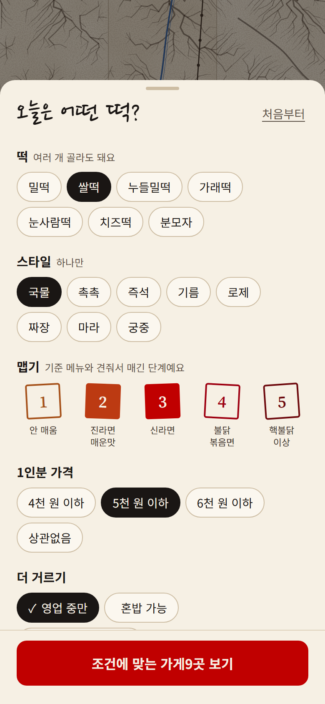
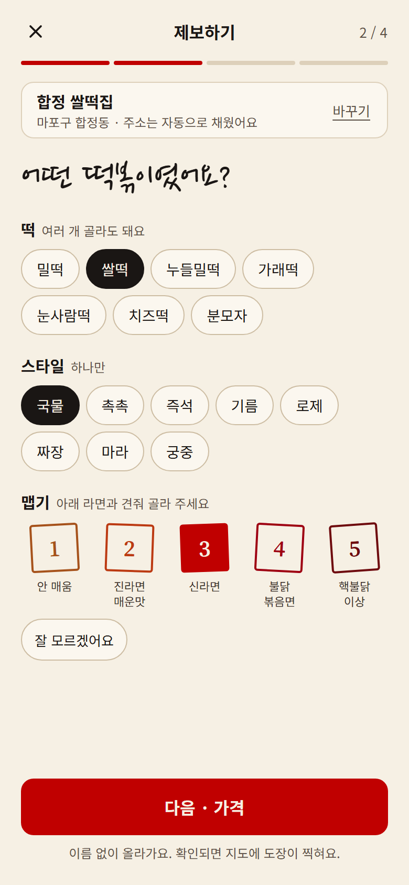

# 떡볶여지도

떡 종류·스타일·맵기 취향으로 찾는 분식(떡볶이) 맛집 지도. 모티브는 거지맵(거지맵.com).

이 폴더에 떡볶여지도 관련 내용을 전부 모은다. 기획안·시안은 덮어쓰지 않고 v1, v2로 따로 둔다.

## 화면 시안 v1 (와이어프레임 7장)

<table>
<tr>
<td align="center"> 첫 화면</td>
<td align="center"> 지도 홈</td>
<td align="center"> 취향 필터</td>
<td align="center"> 제보하기</td>
</tr>
</table>

가게 상세·목록 페이지·지도 스타일까지 7장 전부: [화면시안_v1_2026-10-26/](화면시안_v1_2026-10-26/README.md)

## 파일

| 파일 | 내용 |
| --- | --- |
| [화면시안_v1_2026-10-26/](화면시안_v1_2026-10-26/README.md) | 화면 시안 7장 사본(온라인 캔버스: https://claude.ai/artifact/4s1qqtA3RWLs9rZbYHMyP8) |
| [기획안_v4_2026-10-26.md](기획안_v4_2026-10-26.md) | 최신 기획안. 맵기 기준 신라면=3 확정, 지도 디자인을 대동여지도 느낌으로(8·9·13절) |
| [참고_대동여지도.jpg](참고_대동여지도.jpg) | 사용자 참고 이미지: 지도는 이런 느낌으로(대동여지도, 김정호 1861) |
| [기획안_v3_2026-10-25.md](기획안_v3_2026-10-25.md) | 시장조사 결과를 5·7·10·11·13절에 반영 |
| [시장조사_v1_2026-10-25.md](시장조사_v1_2026-10-25.md) | 유사 서비스 20곳(국내·해외), 떡볶이 취향 데이터, 맵기 기준표 초안 |
| [기획안_v2_2026-10-25.md](기획안_v2_2026-10-25.md) | 8절 브랜딩에 한지·붓글씨 컨셉 반영본 |
| [기획안_v1_2026-10-25.md](기획안_v1_2026-10-25.md) | 첫 기획안(분식집 간판 컨셉), 원본 보관 |
| [KakaoTalk_20261025_225207295.png](KakaoTalk_20261025_225207295.png) | 사용자 컨셉 이미지: 한지 바탕, 빨간 붓글씨 로고, 세 줄 슬로건 |

온라인 원본(탭 2개: 기획안 · 시장조사, 그림 3개 포함, 수정은 여기서): https://claude.ai/artifact/64kZZtqct2fqTKxkjHbVQX
로컬 .md 에는 그림이 빠져 있다(기획안 6절 화면 흐름도·12절 로드맵은 자리표시만, 시장조사 포지션 지도는 표로 옮김).

깃허브(팀 조직 Dduck-dong-map, 비공개, 구성원 Luceta·startingg): https://github.com/Dduck-dong-map/tteokbokki-yeojido

## 기록

### 2026-10-26 (2) 깃허브 올림

- 사용자 요청으로 팀 조직 `Dduck-dong-map` 에 비공개 저장소 `tteokbokki-yeojido` 를 새로 만들고 이 폴더를 통째로 올림(기본 브랜치 main).
- 사용자 「와이어프레임 화면도 공유해야 한다」 → `.dc.html` 은 캔버스 밖에서 안 열려서, 캔버스 런타임과 그림 원본을 받아 로컬에서 7장을 PNG로 찍음 → `화면시안_v1_2026-10-26/화면_이미지/`. 이 README와 시안 README에 바로 보이게 붙임.
- 찍다가 찾은 것: 03 취향 필터 버튼 「가게9곳」 빈칸 빠짐 → 시안 v2 때 고치기.

### ⏸ 2026-10-26 마감

- 사용자 결정: 맵기 기준 **신라면=3 확정**, 다음 작업 = **화면 시안**. 온라인 문서 13절 두 칸 체크, 7절 문단 고침.
- 사용자 참고 이미지(대동여지도): "지도는 이런 느낌으로" → 8절에 「지도 바탕」 추가, 「지도 핀」을 그릇 → **빨간 도장(숫자=맵기)**, 「바탕 질감」은 지도에도 한지. 컨셉 이미지의 점선 격자는 첩 이음선으로 살림.
- 9절: 바탕 지도를 꾸미려면 지도 엔진 선택 필요(네이버 커스텀 스타일 / OSM+MapLibre / 카카오맵 유지). 카카오맵 꾸미기 기능은 못 찾음(확인 필요). 13절에 새 결정 칸 추가.
- 화면 시안 v1: 7장(첫 화면·지도 홈·취향 필터·가게 상세·제보하기·목록 페이지·지도 스타일). 로고·슬로건은 컨셉 이미지에서 오려 씀. 글꼴은 임시(Noto Sans KR·Nanum Pen Script·Song Myung).
- 기획안 v4 로컬 저장(v3에 오늘 바뀐 것만 반영).
- 사용자 반응: 시안 v1 「좋아」 → 저장·정리하고 마감. 폴더 사본과 온라인 캔버스 최신판(version 1792949364-9ca1)이 같은지 파일 크기로 대조함.
- 시안 화면 7장은 Claude 가 화면으로 열어 보지는 못함(지도 바탕 그림·오린 로고만 직접 확인). 깨진 곳은 사용자가 보면서 알려 주기로.

### ⏸ 2026-10-25 (3) 마감

- 유사 프로덕트 시장조사 → 온라인 문서에 「시장조사」 탭 추가 + 시장조사_v1.md.
  - 결론: 떡 종류·맵기 필터 + 익명 제보 떡볶이 지도는 국내외에 없음. 가까운 모델 = HappyCow(3등급), 두쫀쿠맵(자동 숨김), 거지맵(숫자 등재 기준).
- 기획안 v3 반영: 등재 3등급, '아직 있어요' 버튼, 최근 7일 제보 수 공개, 맵기 기준표 초안(진라면 매운맛=2·신라면=3·불닭=4·핵불닭+=5), 태그 추가(누들밀떡·분모자·마라), 비교 질문, 내 기록 내려받기, 노출 순서 판매 금지·전면 광고 금지, 지역 취향 리포트(기업용), 연례 '지역 100곳'·페스티벌.
- 「▶ 재개」 체크리스트는 그대로(4번 맵기 기준은 초안이 생겨 '확정'만 남음).

### ⏸ 2026-10-25 (2) 마감

- 기획안 v1을 이 폴더에 저장.
- 사용자 컨셉 이미지를 8절 브랜딩에 반영 → v2.
  - 느낌: 학교 앞 분식집 간판 → 한지에 붓펜으로 눌러 쓴 편지
  - 색: 한지 미색 #ECE1CF · 붓 빨강 #C00000 · 먹색 #000000 (튀김 노랑 강조색은 뺌)
  - 슬로건: "떡볶이를 사랑하는 사람에 의한, ~을 위한, ~들의 지도" (계단식 세 줄)
  - 로고는 왼쪽 위 크게 + 오른쪽 아래 작은 서명
  - 빨간 물결 밑줄·점선 격자는 편집 화면 표시로 보고 뺌 (사용자 확인 안 함)

**▶ 재개 (다음 날 여기서 시작):** 시안 v1은 사용자가 「좋아」 함(10-26). 다음 작업은 사용자에게 고르게 하기:
- 가) 시안 다듬기 → v2로 따로 (덮어쓰지 않기)
- 나) 지도 엔진부터 정하기(아래 7번) → 대동여지도 바탕을 실제 지도에 입힐 수 있는지 작은 시험
- 다) 아래 남은 결정 정리 후 개발 시작

기획안 13절 남은 결정 5개
1. 서비스 범위 (떡볶이만 / 분식 전체)
2. 첫 출시 지역 (마포·서대문?)
3. 도메인·영문 이름 (구매는 사용자)
4. ~~맵기 1~5 기준 메뉴~~ → 신라면=3 확정 (10-26)
5. ~~다음 작업~~ → 화면 시안 v1 (10-26)
6. 컨셉 이미지 손글씨: 직접 쓴 것인지 글꼴인지, 상업 사용 가능 여부
7. 지도 엔진: 네이버 커스텀 스타일 / OSM+MapLibre / 카카오맵 유지 (새로 생김, 10-26)
