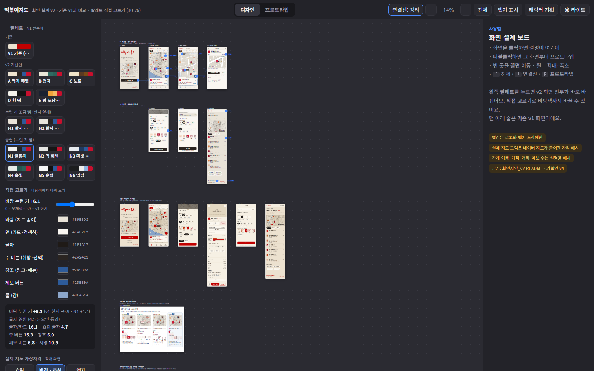
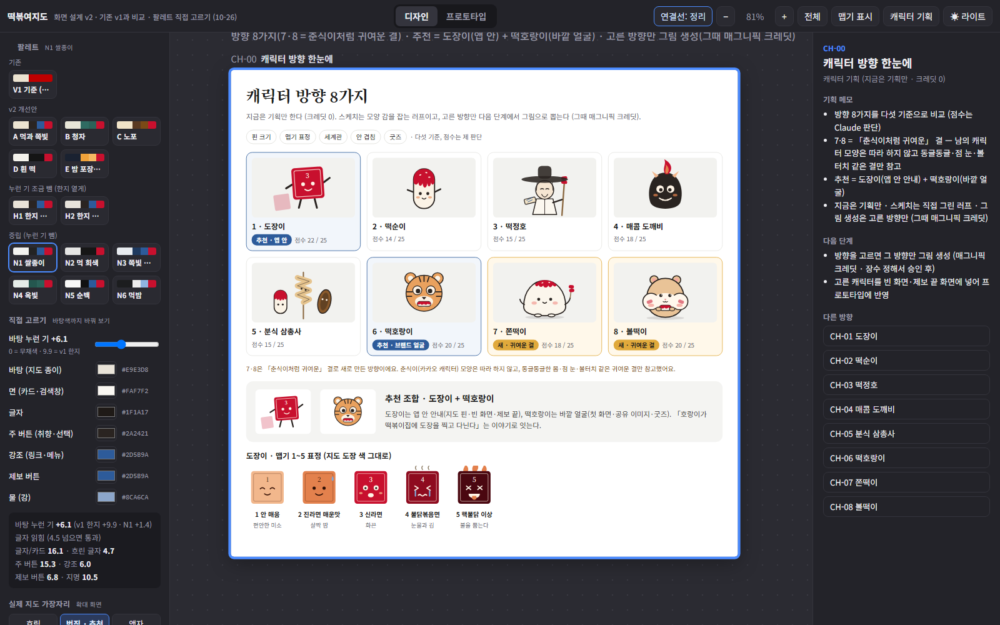
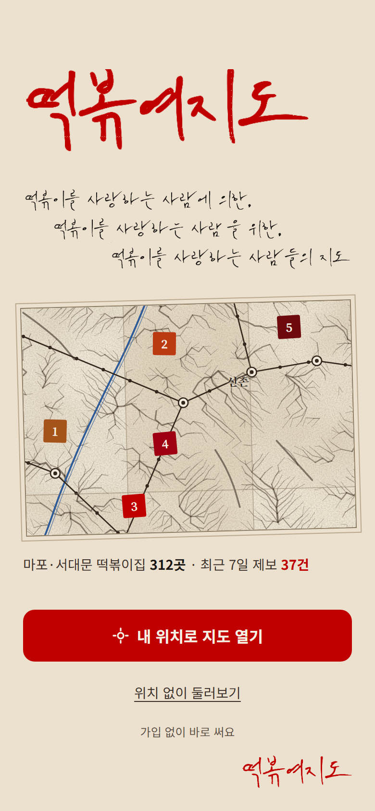

# 떡볶여지도

떡 종류·스타일·맵기 취향으로 찾는 분식(떡볶이) 맛집 지도. 모티브는 거지맵(거지맵.com).

작업물은 전부 [`docs/`](docs/) 폴더에 있다. 기획안·시안은 덮어쓰지 않고 v1, v2로 따로 둔다.

## 화면 설계 보드 (시안 v2 · 지금 기준)

`docs/design/index.html` 을 크롬으로 열면 화면 설계 보드가 뜬다. 디자인/프로토타입 모드가 있고, 기존 v1과 나란히 볼 수 있고, 팔레트를 직접 고를 수 있다.

<table>
<tr>
<td align="center"> 프로토타입: 왼쪽 기존 v1 · 오른쪽 개선안</td>
<td align="center"> 디자인 모드: 화면 흐름 · 왼쪽 팔레트 칸</td>
</tr>
<tr>
<td align="center"> 맵기 표시 4안 (고르는 중)</td>
<td align="center"> 캐릭터 방향 8가지 (고르는 중)</td>
</tr>
</table>

**여는 법:** 저장소를 내려받는다(초록 「Code」 → 「Download ZIP」 또는 `git clone`). 그다음 `docs/design/index.html` 을 크롬으로 열면 된다. 인터넷 서버는 필요 없다.

- 화면을 더블클릭하면 그 화면부터 프로토타입이 시작되고, 누를 수 있는 곳을 누르면 넘어간다.
- 왼쪽 칸에서는 팔레트(바탕색 직접 고르기·누런 기 밀대), 맵기 표시 방식, 실제 지도 가장자리를 바꿀 수 있다.
- 위쪽 「맵기 표시」 버튼은 맵기 표시 4안 비교판으로, 「캐릭터 기획」 버튼은 캐릭터 8가지 판으로 간다.
- 주소 뒤에 `?pal=H1` `?sp=count` `?focus=ch_all` `#home` 을 붙여 바로 열 수도 있다.

## 화면 시안 v1 (와이어프레임 7장)

<table>
<tr>
<td align="center"> 첫 화면</td>
<td align="center"> 지도 홈</td>
<td align="center"> 취향 필터</td>
<td align="center"> 제보하기</td>
</tr>
</table>

가게 상세·목록 페이지·지도 스타일까지 7장 전부: [docs/화면시안_v1_2026-10-26/](docs/화면시안_v1_2026-10-26/README.md)

## 파일 (전부 `docs/` 안)

| 파일 | 내용 |
| --- | --- |
| [docs/design/](docs/design/index.html) | **화면 설계 보드**(위). v2 화면 7개, 기존 v1 6장, 맵기 표시 4안, 캐릭터 8가지, 팔레트 직접 고르기 |
| [docs/화면시안_v2_2026-10-26/](docs/화면시안_v2_2026-10-26/README.md) | 시안 v2 화면 이미지 18장: 빨강 줄인 메인, 팔레트 13가지, 지도 확대, 캐릭터 방향(온라인 캔버스: https://claude.ai/artifact/H2LhhK7Zv7eiUA3ERP2HQ6) |
| [docs/화면시안_v1_2026-10-26/](docs/화면시안_v1_2026-10-26/README.md) | 화면 시안 v1 이미지 7장(온라인 캔버스: https://claude.ai/artifact/4s1qqtA3RWLs9rZbYHMyP8) |
| [docs/기획안_v4_2026-10-26.md](docs/기획안_v4_2026-10-26.md) | **기획안(최신본 하나만 둔다).** 시장조사 반영, 맵기 기준 신라면=3 확정, 지도 디자인 대동여지도 느낌(8·9·13절) |
| [docs/참고_대동여지도.jpg](docs/참고_대동여지도.jpg) | 사용자 참고 이미지: 지도는 이런 느낌으로(대동여지도, 김정호 1861) |
| [docs/시장조사_v1_2026-10-25.md](docs/시장조사_v1_2026-10-25.md) | 유사 서비스 20곳(국내·해외), 떡볶이 취향 데이터, 맵기 기준표 초안 |
| [docs/KakaoTalk_20261025_225207295.png](docs/KakaoTalk_20261025_225207295.png) | 사용자 컨셉 이미지: 한지 바탕, 빨간 붓글씨 로고, 세 줄 슬로건 |

**깃에 올리는 것:** 최신 기획안 하나, 시장조사, 참고 이미지, 화면 설계 보드, 시안 화면 이미지. 옛 기획안(v1~v3), 캔버스 사본(`.dc.html`)과 그 그림, 만들 때 쓴 스크립트는 작업한 컴퓨터에만 둔다(`.gitignore`). 예전 커밋 기록에도 남아 있어서 필요하면 꺼낼 수 있다.

온라인 원본(탭 2개: 기획안 · 시장조사, 그림 3개 포함, 수정은 여기서): https://claude.ai/artifact/64kZZtqct2fqTKxkjHbVQX
로컬 .md 에는 그림이 빠져 있다(기획안 6절 화면 흐름도·12절 로드맵은 자리표시만, 시장조사 포지션 지도는 표로 옮김).

깃허브(팀 조직 Dduck-dong-map, 비공개, 구성원 Luceta·startingg): https://github.com/Dduck-dong-map/tteokbokki-yeojido

## 기록

> 10-26 (10) 부터 작업물은 전부 `docs/` 안에 있다. 그 전 기록에 나오는 `design/`·`화면시안_v2_…/` 같은 경로는 이제 `docs/` 아래에 있다.

### 2026-10-26 (11) 깃에는 필요한 것만

- 사용자: 「기획안 버전이 왜 이렇게 많냐? 깃에는 필요 없는 파일은 지우고 필요한 것만, 아무거나 지우란 말은 아님」
- 깃에서만 뺌(이 컴퓨터에는 그대로): 옛 기획안 v1~v3(v4에 다 들어 있음) · 시안 v1·v2 캔버스 사본 `화면/`(`.dc.html`, canvas.json — 캔버스 밖에선 안 열림)과 그것만 쓰는 `그림/` · `만든_스크립트/` 3곳. `.gitignore` 에 적어 둠.
- 보드의 기존 v1 사진 6장(`docs/design/img/v1_01~06.png`)은 시안 v1 `화면_이미지/` 와 똑같은 파일(같은 해시)이라 지우고, 보드가 그쪽을 불러오게 고침 → 보드 화면 확인함.
- 남긴 것: 최신 기획안 · 시장조사 · 참고 이미지 2 · 화면 설계 보드 · 시안 v1·v2 README와 화면 이미지.

### 2026-10-26 (10) docs 폴더로 묶어 깃허브에 올림

- 사용자: 「design/index.html 우리 작업 깃허브에 업로드」 · 「docs가 최상위 다이렉트 폴더로 해서 묶어서 올려줘」
- 저장소 맨 위에 `docs/` 를 두고 기획안·시장조사·참고 이미지·시안 v1·v2·화면 설계 보드를 전부 그 안으로 옮김. 맨 위에는 README만 남김.
- 보드 화면 4장(프로토타입·디자인 모드·맵기 표시 4안·캐릭터 8가지)을 찍어 `docs/design/화면_이미지/` 에 넣고, 이 README 첫머리에 붙임 → 깃허브에서 내려받지 않아도 보임. 여는 법도 적음.
- `docs/화면시안_v1_…/만든_스크립트/cut_logo.py` 의 컨셉 이미지 경로를 docs 안으로 고침. 다른 링크는 폴더끼리 상대 경로라 그대로 살아 있음.

### 2026-10-26 (9) 귀여운 캐릭터 2 · 맵기 표시 4안

- 사용자: 「춘식이처럼 귀여운 캐릭터도 시안 추가」 · 「맵기 단계 지금도 좋고, 고추 숫자로 표시하는 것도 시안 추가 → 보고 결정」
- 캐릭터 7 **쫀떡이**(말랑한 떡 한 조각 몸·점 눈·볼터치·머리에 소스) · 8 **볼떡이**(볼주머니에 떡 가득 햄스터, 매울수록 볼이 빨개짐). 춘식이(카카오) 모양은 따라 하지 않고 「동글동글·점 눈·볼터치」 결만 참고. 러프 스케치 `design/img/char_7·8.svg`. 크레딧 0.
- 맵기 표시: 보드 왼쪽 칸 「맵기 표시」 = 도장 숫자(지금) / 고추 개수 / 고추 핀+숫자 / 섞기(지도 핀=도장, 카드·필터=고추 개수, 추천) → 누르면 프로토타입 화면 전체가 그 방식으로. 비교판 SP-00(위쪽 「맵기 표시」 버튼). 고추 개수는 고추를 늘 고추 빨강, 테두리만 맵기 색.

### 2026-10-26 (8) 누런 기 조금 뺀 판 · 캐릭터 기획을 보드에

- 사용자: 「누런 기를 조금만 뺀 버전」 · 「캐릭터 기획안은 어디 있니?」
- 보드 팔레트에 「누런 기 조금 뺌」 묶음: **H1 한지 옅게 +6**(바탕 #E9E3D8 · 카드 #FAF7F2) · **H2 한지 더 옅게 +4**(#E7E3DC · #F9F7F4), 먹·쪽빛은 A 그대로. 직접 고르기에 **「바탕 누런 기」 밀대**(0~15, 밝기는 그대로) + 지금 누런 기 수치 표시.
- 보드에 **「캐릭터 기획」 줄** 추가(맨 아래, 위쪽 「캐릭터 기획」 버튼으로 바로 이동): CH-00 한눈에(6방향·점수·추천 조합·도장이 표정 1~5) + CH-01~06 방향별 판(스케치·설명·점수·그림 프롬프트). 크레딧 0.
- 보드 주소 뒤 `?pal=H1` · `?focus=ch_all` · `#home` 으로 바로 열 수 있음.

### 2026-10-26 (7) 화면 설계 보드 · 프로토타입 (데이팅 앱 보드 방식)

- 사용자: 「바탕색도 커스텀할 수 있는 팔레트」 · 「프로토타입은 어디 있니? 데이팅 앱 만들었던 것처럼」
- **`design/index.html`** (로컬 웹 페이지, 브라우저로 연다) = 데이팅 앱 B3 보드와 같은 틀: 디자인/프로토타입 모드, 화면 목록, 연결선, 확대·축소, 라이트/다크.
  - v2 화면 7개: N-01 첫 화면 · N-02 지도 홈 · N-03 취향 필터 · N-04 확대·실제 지도 · N-05 가게 위치 · N-06 제보하기 · N-07 목록. 누르면 넘어가는 프로토타입(＋ 확대 버튼 새로 넣음).
  - 아래 줄 = 기존 v1 화면 6장(사진). 프로토타입 「기존(v1)과 나란히」(기본 켬) = 왼쪽 폰 v1, 오른쪽 폰 개선안.
  - 왼쪽 팔레트 칸: 프리셋 12(+V1) 누르기 + **직접 고르기 7색(바탕 종이·면·글자·주 버튼·강조·제보·물)** → 모든 화면에 바로. 나머지 색(윗줄·선·흐린 글자·지도 먹선·실제 지도 칸)은 자동 계산, 대비 수치 바로 표시, 「색 값 보기·복사」로 고른 색을 채팅에 붙여 줄 수 있음. 가장자리 흐림/번짐/액자도 여기서.
  - 지도는 색을 바꿀 수 있는 지도(`design/만든_스크립트/gen_symbols.py` 가 index.html 안에 넣음, 지형은 gen_map_v2 그대로).
- 캔버스 스튜디오는 그대로 두되, 이제 프로토타입·팔레트 확인은 이 보드가 기준.

### 2026-10-26 (6) 페이지 합치기 · 기존과 나란히

- 사용자: 「말로만 하지 말고 띄워라, 새 창·새 페이지 말고 기존 페이지를 디벨롭」 · 「개선안은 기존 디자인과 비교되게, 팔레트 눌러서 확인하는 형식」
- 캔버스 페이지 6 → 4: 「중립 팔레트」 → 「색 팔레트」(기존 팔레트판 옆), 「지도 확대」·중립 비교 → 「메인 화면」 아래. 판 내용은 그대로, 자리만 옮김.
- 스튜디오 개선안 탭: 팔레트 칩 줄 + 각 개선안 왼쪽 기존 디자인(v1 실제 화면 사진)·오른쪽 개선안(누른 팔레트). 지도 홈 · 확대하면 실제 지도(가장자리 칩) · 가게 위치(v1 가게 상세 사진과 비교) · 도장 색.
- 프로토타입 탭도 처음부터 「기존과 나란히」(왼쪽 v1 색 · 오른쪽 개선안).
- 고친 뒤 캔버스를 직접 띄움.

### 2026-10-26 (5) 스튜디오 · 프로토타입

- 사용자: 캔버스 페이지(#page-2e9cfe98992d)에 개선안·비교 시안 올리고, 웹 스튜디오 + 프로토타입 + 팔레트 비교 + 캐릭터 기획 방향.
- 그 페이지 id가 캔버스 파일에 없어서(저장 전) 같은 id로 「스튜디오」 페이지를 만들고 첫 페이지·시작 화면으로 둠.
- `Studio.dc.html` 탭 5개: 프로토타입(화면 3개 누르며 넘기기, 팔레트 13 즉시 바꾸기, 두 팔레트 나란히) · 개선안 비교 · 팔레트 13 · 캐릭터 방향 · 고를 것. 자세한 건 화면시안_v2 README.
- 깃허브는 아직 안 올림.

### 2026-10-26 (4) 중립 팔레트 · 확대하면 실제 지도

- 사용자: 「배경에도 붉은 기 → 뺀 색상 템플릿 여러 개」 · 「확대하면 네이버 지도 연동(사이드는 블러라도) 해야 정확한 위치를 알지 않나」
- 재 보니 v1 한지 바탕은 붉은 기(+0.1)보다 누런 기(+9.9)가 문제. 중립 팔레트 6가지(N1 쌀종이 추천 ~ N6 먹밤) 추가.
- 확대 구조 제안: 그림 지도(구·동네) → 실제 네이버 지도(골목) → 가게 위치·길찾기. 가장자리 흐림/번짐(추천)/액자 비교.
- 네이버 지도 API: 스타일 편집기 있음, 무료 이용량은 대표 계정만(수치는 콘솔 확인 필요). 자세한 건 화면시안_v2 README.
- 걸리는 점: 그림 지도가 실제 축척이 아니라 실제 지도와 이어 붙이면 강·길이 어긋남 → 실제 좌표로 다시 그려야 함.
- 캔버스에 페이지 2개(중립 팔레트·지도 확대) 추가. 깃허브는 아직 안 올림.

### 2026-10-26 (3) 시안 v2 시작

- 사용자: 「지금까지가 v1, 이제 v2. 메인에 붉은색이 너무 많다 · 캐릭터도 만들자(크레딧 쓰지 말고 기획·방향만) · 색은 팔레트로 비교」
- 새 캔버스 「떡볶여지도 시안 v2」(v1 캔버스는 그대로) → 사본 `화면시안_v2_2026-10-26/`.
- 메인: 빨강 11곳 → 로고·도장·맵기 태그만. 도장 1~5 색을 밝기 순으로 새로(살구→검붉음).
- 팔레트 6가지(V1·A 먹과 쪽빛·B 청자·C 노포·D 흰 떡·E 밤 포장마차), 팔레트마다 지도 바탕도 새로 그림(gen_map_v2.py). 추천 A, E는 밤 모드 후보.
- 캐릭터 6가지 기획 + 러프 스케치(직접 그린 선, 크레딧 0). 추천 = 도장이(앱 안) + 떡호랑이(브랜드 얼굴).
- 깃허브에는 아직 안 올림(사용자 요청 때만).

### 2026-10-26 (2) 깃허브 올림

- 사용자 요청으로 팀 조직 `Dduck-dong-map` 에 비공개 저장소 `tteokbokki-yeojido` 를 새로 만들고 이 폴더를 통째로 올림(기본 브랜치 main).
- 사용자 「와이어프레임 화면도 공유해야 한다」 → `.dc.html` 은 캔버스 밖에서 안 열려서, 캔버스 런타임과 그림 원본을 받아 로컬에서 7장을 PNG로 찍음 → `화면시안_v1_2026-10-26/화면_이미지/`. 이 README와 시안 README에 바로 보이게 붙임.
- 찍다가 찾은 것: 03 취향 필터 버튼 「가게9곳」 빈칸 빠짐 → 시안 v2 때 고치기.

### ⏸ 2026-10-26 마감

- 사용자 결정: 맵기 기준 **신라면=3 확정**, 다음 작업 = **화면 시안**. 온라인 문서 13절 두 칸 체크, 7절 문단 고침.
- 사용자 참고 이미지(대동여지도): "지도는 이런 느낌으로" → 8절에 「지도 바탕」 추가, 「지도 핀」을 그릇 → **빨간 도장(숫자=맵기)**, 「바탕 질감」은 지도에도 한지. 컨셉 이미지의 점선 격자는 첩 이음선으로 살림.
- 9절: 바탕 지도를 꾸미려면 지도 엔진 선택 필요(네이버 커스텀 스타일 / OSM+MapLibre / 카카오맵 유지). 카카오맵 꾸미기 기능은 못 찾음(확인 필요). 13절에 새 결정 칸 추가.
- 화면 시안 v1: 7장(첫 화면·지도 홈·취향 필터·가게 상세·제보하기·목록 페이지·지도 스타일). 로고·슬로건은 컨셉 이미지에서 오려 씀. 글꼴은 임시(Noto Sans KR·Nanum Pen Script·Song Myung).
- 기획안 v4 로컬 저장(v3에 오늘 바뀐 것만 반영).
- 사용자 반응: 시안 v1 「좋아」 → 저장·정리하고 마감. 폴더 사본과 온라인 캔버스 최신판(version 1792949364-9ca1)이 같은지 파일 크기로 대조함.
- 시안 화면 7장은 Claude 가 화면으로 열어 보지는 못함(지도 바탕 그림·오린 로고만 직접 확인). 깨진 곳은 사용자가 보면서 알려 주기로.

### ⏸ 2026-10-25 (3) 마감

- 유사 프로덕트 시장조사 → 온라인 문서에 「시장조사」 탭 추가 + 시장조사_v1.md.
  - 결론: 떡 종류·맵기 필터 + 익명 제보 떡볶이 지도는 국내외에 없음. 가까운 모델 = HappyCow(3등급), 두쫀쿠맵(자동 숨김), 거지맵(숫자 등재 기준).
- 기획안 v3 반영: 등재 3등급, '아직 있어요' 버튼, 최근 7일 제보 수 공개, 맵기 기준표 초안(진라면 매운맛=2·신라면=3·불닭=4·핵불닭+=5), 태그 추가(누들밀떡·분모자·마라), 비교 질문, 내 기록 내려받기, 노출 순서 판매 금지·전면 광고 금지, 지역 취향 리포트(기업용), 연례 '지역 100곳'·페스티벌.
- 「▶ 재개」 체크리스트는 그대로(4번 맵기 기준은 초안이 생겨 '확정'만 남음).

### ⏸ 2026-10-25 (2) 마감

- 기획안 v1을 이 폴더에 저장.
- 사용자 컨셉 이미지를 8절 브랜딩에 반영 → v2.
  - 느낌: 학교 앞 분식집 간판 → 한지에 붓펜으로 눌러 쓴 편지
  - 색: 한지 미색 #ECE1CF · 붓 빨강 #C00000 · 먹색 #000000 (튀김 노랑 강조색은 뺌)
  - 슬로건: "떡볶이를 사랑하는 사람에 의한, ~을 위한, ~들의 지도" (계단식 세 줄)
  - 로고는 왼쪽 위 크게 + 오른쪽 아래 작은 서명
  - 빨간 물결 밑줄·점선 격자는 편집 화면 표시로 보고 뺌 (사용자 확인 안 함)

**▶ 재개 (다음에 여기서 시작):** 화면 설계 보드 `docs/design/index.html` 을 연다(결과 보여 줄 때도 이 보드). 사용자가 팔레트(직접 고른 색이면 「색 값 보기·복사」 값)·가장자리·캐릭터를 고르기 기다림(10-26). 캔버스 스튜디오는 보조.
- 고를 것 ① 팔레트(10-26 저녁 중립 6가지 추가 → 추천 N1 쌀종이 + 밤 모드 N6 먹밤) ② 캐릭터 방향(추천 1 도장이 + 6 떡호랑이) ③ 핀에 얼굴 넣기(추천 「숫자 + 작은 눈」) ④ 실제 지도 가장자리(추천 번짐) ⑤ 지도 엔진 = 네이버로 확정할지 ⑥ 맵기 표시(도장 숫자 / 고추 개수 / 고추 핀 / 섞기, 추천 섞기) — 캐릭터는 7 쫀떡이·8 볼떡이(귀여운 결)도 후보
- 네이버로 가면: 사용자가 네이버 클라우드 콘솔에서 Maps 신청·키 발급(계정 일은 사용자 몫) → 스타일 편집기로 N1 색 맞춘 시험 지도 → 그림 지도를 실제 좌표로 다시 그리기
- 고르면: 고른 팔레트로 나머지 화면(첫 화면·필터·상세·제보·목록) v2 → 캐릭터는 고른 방향만 그림 생성(이때부터 매그니픽 크레딧, 장수 정해서 승인 받기)
- v2 때 고칠 것: 취향 필터 버튼 「가게9곳」 빈칸
- 그다음: 지도 엔진(아래 7번) 정하기 → 남은 결정 정리 후 개발

기획안 13절 남은 결정 5개
1. 서비스 범위 (떡볶이만 / 분식 전체)
2. 첫 출시 지역 (마포·서대문?)
3. 도메인·영문 이름 (구매는 사용자)
4. ~~맵기 1~5 기준 메뉴~~ → 신라면=3 확정 (10-26)
5. ~~다음 작업~~ → 화면 시안 v1 (10-26)
6. 컨셉 이미지 손글씨: 직접 쓴 것인지 글꼴인지, 상업 사용 가능 여부
7. 지도 엔진: 네이버 커스텀 스타일 / OSM+MapLibre / 카카오맵 유지 (새로 생김, 10-26)
