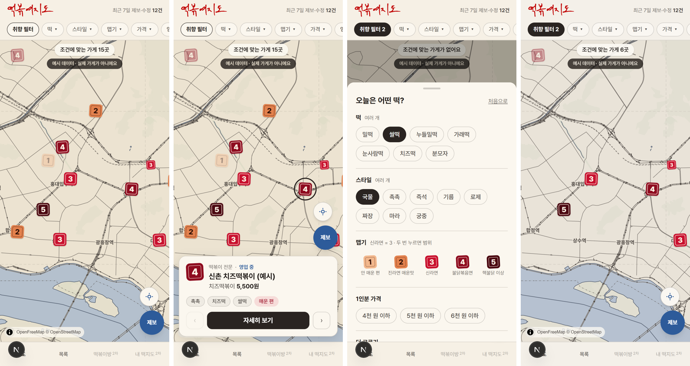
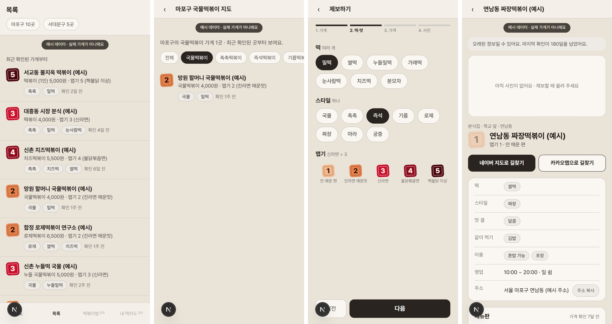

# 떡볶여지도 개발 준비 v1

2026-10-27 · 기획안 v4 기준

## 1. 한눈에

- **웹앱(PWA)으로 먼저 만든다.** 앱은 같은 코드로 나중에 만든다. 안드로이드가 먼저고, iOS는 월 이용자 1만 명을 넘긴 뒤에 만든다. 기획안 9절과 같은 결론이다.
- **개발 뼈대(M0)를 만들었다.** 폴더는 `web/` 이다. 지도 홈, 취향 필터, 가게 카드, 가게 상세, 목록, 지역·취향 목록, 제보 4단계가 실제로 돌아간다. 가게는 예시 데이터 16곳이고, 화면에 「예시 데이터 · 실제 가게가 아니에요」라고 띄운다.
- **가장 먼저 정할 것은 지도 엔진이다.** 뼈대에는 키 없이 바로 쓸 수 있는 오픈 지도(OpenStreetMap + MapLibre)로 대동여지도 느낌을 시험으로 입혀 두었다. 네이버로 정하면 지도 파일 2개만 바꾸면 된다(4절).





## 2. 웹앱이냐 앱이냐

| | 모바일 웹앱 (PWA) | 안드로이드 앱 | iOS 앱 |
| --- | --- | --- | --- |
| 쓰는 사람 | 링크 누르면 바로. 홈 화면에 추가하면 앱처럼 열림 | 플레이 스토어에서 설치 | 앱 스토어에서 설치 |
| 검색 유입 | 「마포구 쌀떡볶이」 같은 목록 페이지가 검색에 걸림 | 없음 | 없음 |
| 만드는 법 | 지금 만든 `web/` 그대로 | 같은 웹앱을 감싸서 올림(TWA) | 같은 코드를 Capacitor로 감싸고 앱다운 기능을 붙임 |
| 심사·비용 | 없음 | 개발자 등록비 한 번 | 해마다 등록비, 심사 있음 |
| 언제 | **지금** | 월 1만 명 넘으면 | 그다음 |

- 거지맵도 웹으로 시작했다. 「앱 설치 없이 쓴다」가 입소문의 이유였다.
- 애플은 웹을 그대로 감싼 앱을 「기능 부족」(심사 기준 4.2)으로 자주 거절한다. iOS 앱을 낼 때는 오프라인 화면, 근처 가게 알림, 공유 같은 앱 기능을 함께 넣어야 한다.

## 3. 기술 구성 (확인한 사실)

| 영역 | 선택 | 상태 | 확인한 것 |
| --- | --- | --- | --- |
| 화면 | Next.js 16.4 + React 19 + Tailwind 4 | ✅ 뼈대 | 새 캐시 방식(Cache Components)이 기본으로 켜져 있어서 그 방식대로 짰다 |
| 지도 | MapLibre 6 + OpenFreeMap 타일 | ✅ 시험 | 키·가입 없음, 상업 사용 가능, 이용량 제한 없음(공식 안내). 출처 표기는 넣었다 |
| 데이터·로그인 | Supabase (Postgres + PostGIS) | 📝 설계만 | 무료: DB 500MB, 7일 동안 안 쓰면 멈춤. 2026-10-30부터 표마다 읽기 권한(GRANT)을 직접 줘야 해서 SQL에 넣었다 |
| 배포 | Vercel | ⏳ | 사용자가 이미 쓰는 곳(saret-system) |
| 제보 주소 검색 | 행정안전부 도로명주소 API | ⏳ | 승인키를 받아야 한다. 지금 제보 화면은 직접 입력 |
| 첫 가게 후보 | 공공데이터포털 일반음식점 인허가 | ⏳ | 2026년 1월부터 지방행정 인허가 데이터가 data.go.kr 한 곳으로 모였다 |
| 사진 | Supabase Storage (올릴 때 줄이기) | ⏳ | M2 |
| 분석 | GA4 + Vercel Analytics | ⏳ | 기준 지표 = 필터를 쓴 뒤 길찾기를 누른 비율 |

## 4. 지도 엔진 고르기 (가장 큰 결정)

| | ① 네이버 지도 + 스타일 편집기 | ② 오픈 지도 + MapLibre (뼈대에 넣은 것) | ③ 카카오맵 그대로 |
| --- | --- | --- | --- |
| 대동여지도 느낌 | 색은 바꿀 수 있다. 10리 점, 첩 이음선은 위에 따로 덧그려야 한다 | 바탕색, 길, 물, 점, 이음선, 지명 글꼴까지 다 바꾼다. 구 단위부터 골목까지 같은 느낌 | 바탕을 못 바꾼다(공식 문서에서 기능을 못 찾음). 도장 핀과 테두리만 얹을 수 있다 |
| 정확도 | 국내 골목·건물·상호가 가장 정확하다 | 길·건물·역은 충분하다. 상호와 동 이름은 적고, 동 이름은 크게 확대해야 나온다 | 정확하다 |
| 계정·비용 | 네이버 클라우드 가입과 키 발급(사용자 몫). 무료 이용량은 대표 계정만 받는다. 숫자는 콘솔에서만 보인다 | 키 없음, 무료. 사용자가 늘면 대한민국 지도 파일을 우리 저장소에 올려서 직접 내보낸다(월 몇천 원 수준으로 추정) | 카카오 개발자 키. 2026-07부터 새 무료 이용량 정책 |
| 이전 문제 | 그림 지도와 실제 지도를 이어 붙이면 강과 길이 어긋난다(10-26 기록) | **이 문제가 없다.** 처음부터 실제 좌표 위에 대동여지도 색을 입힌다 | 같은 문제 |

**추천은 ②다.** 이유는 세 가지다. 대동여지도 느낌을 끝까지 낼 수 있다. 계정 없이 오늘부터 개발할 수 있다. 「확대하면 실제 지도로 넘어간다」 구조가 필요 없다. 길찾기는 어느 쪽이든 네이버·카카오 지도 앱으로 넘긴다. 결정은 사용자가 한다.

②의 남은 일: 동 이름이 확대해야 나오는 문제는 우리가 동네 이름을 직접 얹어서 해결한다(M1). 사용자가 늘면 지도 파일을 직접 올린다(M5).

①로 정하면 `web/src/components/map/` 의 `dongyeoStyle.ts`(바탕 그림)와 `TteokMap.tsx`(지도 띄우기)만 네이버용으로 바꾼다. 필터, 카드, 데이터 코드는 그대로 둔다.

## 5. 만든 것: M0 개발 뼈대 (`web/`)

| 화면 | 주소 | 되는 것 |
| --- | --- | --- |
| 지도 홈 | `/` | 대동여지도 느낌 지도, 맵기 도장 핀(1~5), 180일 넘은 가게는 바랜 도장, 몰린 곳은 둥근 도장에 가게 수, 내 위치, 제보 버튼, 「최근 7일 제보·수정」 |
| 취향 필터 | `/` 안 시트 | 떡, 스타일, 맵기(신라면 = 3, 두 번 누르면 범위), 1인분 가격, 영업 중, 혼밥, 「메뉴에 있음」 빼기. 고를 때마다 가게 수가 바로 나온다. **필터가 주소에 담겨서** 주소를 그대로 보내면 같은 지도가 열린다 |
| 가게 카드 | `/` 안 | 도장, 대표 메뉴·가격, 영업 중, 태그. 옆으로 밀면 가까운 다음 가게로 간다 |
| 가게 상세 | `/store/[id]` | 메뉴판, 태그, 영업시간, 주소 복사, 네이버·카카오 길찾기, 마지막 확인일, 「아직 있어요」(200m 안에서만), 「정보가 달라요」, 「문 닫았어요」 |
| 목록 | `/list` | 지역 고르기, 최근 확인된 가게부터, 365일 넘은 가게는 내림 |
| 지역·취향 목록 | `/seoul/mapo`, `/seoul/mapo/soup` | 검색 유입용 페이지. 가게가 있는 지역 × 취향 조합만 미리 만든다(지금 22쪽) |
| 제보하기 | `/report` | 4단계(가게 → 떡·맛 → 가격 → 사진). 서버가 같은 규칙으로 다시 검사한다. **아직 저장은 안 한다** |
| 기타 | | 홈 화면 추가(PWA), 임시 앱 아이콘(로고의 「떡」 + 빨간 도장), 사이트맵. 예시 데이터일 때는 검색엔진을 막는다 |

- **팔레트:** 화면 설계 보드의 프리셋 14개와 색 계산을 그대로 옮겼다. 주소 뒤에 `?pal=H1` 처럼 붙이면 보드와 같은 이름으로 바뀐다. 지금 기본은 A다. 사용자가 고르면 `web/src/lib/theme.ts` 의 `DEFAULT_PALETTE` 한 줄만 바꾼다.
- **맵기 표시:** 지금은 「도장 숫자」다. 4안 중 다른 것을 고르면 `web/src/components/map/stamps.ts` 와 `ui.tsx` 의 `SpiceStamp` 만 바꾼다.
- **태그 체계:** 기획안 7절의 표를 `web/src/lib/taxonomy.ts` 로 옮겼다. 화면, 서버 검사, DB가 모두 이 이름을 쓴다.
- **확인:** 타입 검사, 코드 검사(lint), 실서비스용 빌드가 모두 통과했다. 휴대폰 크기(390×844)로 9개 화면을 찍어서 확인했다(위 그림).

## 6. 폴더 구조

```
web/
  src/app/                 화면(주소별)
    page.tsx               지도 홈
    store/[id]/            가게 상세
    list/                  목록
    seoul/[gu]/[taste]/    지역·취향 목록 (검색 유입)
    report/                제보하기
    api/reports/           제보 받기 (서버)
    manifest.ts sitemap.ts robots.ts
  src/components/
    map/                   지도 (dongyeoStyle = 대동여지도 바탕, stamps = 도장 핀)
    home/                  지도 홈 · 필터 시트 · 가게 카드
    report/ store/         제보 · 상세 버튼
  src/lib/
    taxonomy.ts            맛 태그 체계 (기획안 7절)
    theme.ts               팔레트 (보드와 같음)
    filters.ts             필터 · 주소 담기 · 거리
    freshness.ts           180일 흐림 · 365일 내림 · 영업 중
    data/                  데이터 꺼내는 곳 (지금 예시 → M2에 Supabase)
  supabase/migrations/     DB 설계 SQL (아직 적용 안 함)
```

## 7. 데이터 설계 (`web/supabase/migrations/20261027000000_init.sql`)

| 표 | 내용 | 기획안 규칙이 들어간 곳 |
| --- | --- | --- |
| stores | 가게(위치, 태그, 가격, 영업시간, 마지막 확인일) | 태그는 정해진 보기만 받는다(DB가 막음). 맛 결은 최대 2개 |
| menu_items | 메뉴판 | |
| stores_public (뷰) | 화면에서 읽는 모양 | 365일 넘으면 빼고, 180일 넘으면 stale 표시 |
| stores_in_bounds (함수) | 지도에 보이는 칸 안의 가게 | 위치 검색(PostGIS) |
| reports | 제보(새 가게·수정·폐업) | 승인 대기. 기기·IP는 해시로만. 하루 10건 제한용 색인 |
| report_agreements | 가격·맵기 수정 동의 | 다른 기기 2곳이 동의하면 반영 |
| confirmations | 「아직 있어요」 | 서버가 거리를 확인한 뒤 넣는다 |
| spice_votes | 맵기 투표 | 2차 「맛 투표」 대비 |

권한: 누구나 가게와 메뉴를 **읽기만** 한다. 쓰기는 웹 서버가 서버 전용 키로만 한다. 그래야 도배 제한과 근처 확인을 서버에서 검사할 수 있다.

## 8. 단계

관문을 못 넘으면 다음 단계로 가지 않는다(기획안 12절). 기간은 아직 정하지 않았다.

| 단계 | 할 일 | 관문 |
| --- | --- | --- |
| **M0 뼈대** ✅ | 화면 7개, 대동여지도 지도(시험), 팔레트, 태그 체계, DB 설계 | 빌드 통과, 휴대폰 크기 확인 |
| M1 디자인 확정 반영 | 사용자가 고른 팔레트·맵기 표시·핀 얼굴을 코드에 넣는다. 동네 이름 얹기, 손글씨 글꼴, 보드 v2에 맞춰 화면 다듬기 | 보드와 나란히 봐서 사용자 확인 |
| M2 진짜 데이터 | Supabase 프로젝트에 SQL 적용, `lib/data` 교체, 제보·「아직 있어요」 저장, 하루 10건 제한, 주소 검색 | 제보 → DB → 지도까지 한 바퀴 |
| M3 운영 도구 | 제보 승인 화면(버튼 하나), 신고 처리, 180일 지난 가게 목록, 운영자 로그인. **기획·시안: [어드민기획_v1](../기획/어드민기획_v1_2026-10-27.md)** (`/admin` 화면 10개) | 하루 20분 운영 가능 |
| M4 첫 데이터 | 공공데이터 일반음식점에서 분식·떡볶이 후보 → 크루가 직접 확인 → 등록 | **마포·서대문 100곳 이상**(출시 전 300곳 목표) |
| M5 베타·출시 | 도메인, Vercel 배포, GA4, 검색엔진 열기, 지도 파일 직접 올리기(②일 때), 사용자 인터뷰 5~8명 | 베타 한 달 지표 |
| 앱 | 안드로이드(TWA) → iOS(Capacitor + 앱 기능) | 월 1만 명 |

## 9. 사용자가 할 일

**고를 것** (M1을 막는 순서)
1. 지도 엔진: ① 네이버 / ② 오픈 지도(추천) / ③ 카카오
2. 팔레트 · 맵기 표시 · 핀 얼굴 · 실제 지도 가장자리(②로 가면 가장자리는 필요 없다) · 캐릭터 방향: README 「▶ 재개」의 6가지
3. 기획안 13절: 서비스 범위(떡볶이만 / 분식 전체), 첫 지역(마포·서대문), 컨셉 이미지 손글씨가 글꼴인지와 상업 사용 가능 여부

**계정·구매** (사용자가 직접 한다. Claude는 대신 가입하거나 키를 다루지 않는다)
- Supabase 가입과 프로젝트 만들기 (M2)
- 도로명주소 API 승인키 신청 (M2)
- 도메인 구매: 떡볶여지도.com + 영문 주소 (M5)
- Vercel에 저장소 연결 (M5)
- ①을 고르면: 네이버 클라우드 Maps 신청 (대표 계정으로)

**깃허브:** `web/` 은 아직 올리지 않았다. 올리라고 하면 올린다. `node_modules`, 빌드 결과, 키 파일은 `.gitignore` 로 빠진다.

## 10. 돌려 보는 법

```
cd web
npm install
npm run dev
```

크롬에서 `http://localhost:3000` 을 연다. 휴대폰 크기로 보려면 F12 → 휴대폰 아이콘을 누른다. 주소 뒤에 `?pal=H1` 을 붙이면 팔레트가 바뀌고, `?style=soup&spice=3-5` 를 붙이면 필터가 걸린 채로 열린다.

## 11. 아직 확인 못 한 것

- DB 설계 SQL은 아직 실제 Supabase에 적용하지 않아서 검증하지 못했다(M2 첫 일).
- 네이버·카카오 길찾기 링크는 실제 휴대폰에서 아직 눌러 보지 않았다.
- 「내 위치」와 「아직 있어요」는 https 주소에서만 휴대폰 위치를 받는다. 배포한 뒤에 확인한다.
- OpenFreeMap의 「상업 사용 가능」은 공식 질문·답변에서 확인했다. 따로 된 약관 문서는 못 찾았다. 지도 데이터(OpenStreetMap)는 출처를 표기하면 쓸 수 있고, 출처는 지도 왼쪽 아래에 넣었다.
- 네이버 Maps 무료 이용량 숫자는 공개 문서에 없다. 콘솔에서만 보인다.
- 앱 아이콘은 임시다. 캐릭터나 로고가 정해지면 바꾼다.

## 출처

- [OpenFreeMap](https://openfreemap.org) (무료, 키 없음, 상업 사용 가능, 검색·길찾기는 제공 안 함)
- [네이버 클라우드 Maps 이용 안내](https://guide.ncloud-docs.com/docs/maps-procedure) · [스타일 편집기](https://guide.ncloud-docs.com/docs/application-maps-styleeditor-create-vpc) · [무료 이용량은 대표 계정만](https://www.ncloud.com/support/faq/all/948)
- [Next.js 블로그](https://nextjs.org/blog) (16.x)
- [Supabase 무료 플랜 한도 정리 (2026)](https://www.jetadmin.io/blog/supabase-pricing-2026-guide-to-plans-limits-and-real-world-costs/)
- [행정안전부 지방행정 인허가 데이터 통합 개방 (2026-01)](https://newsseoul.co.kr/news/view/1065579617179088) · [전국일반음식점표준데이터](https://www.data.go.kr/data/15096283/openapi.do)
- [PWA를 iOS 앱으로: 심사 기준 4.2 주의점](https://vp0.com/blogs/convert-pwa-to-ios-app-fast-2026)
