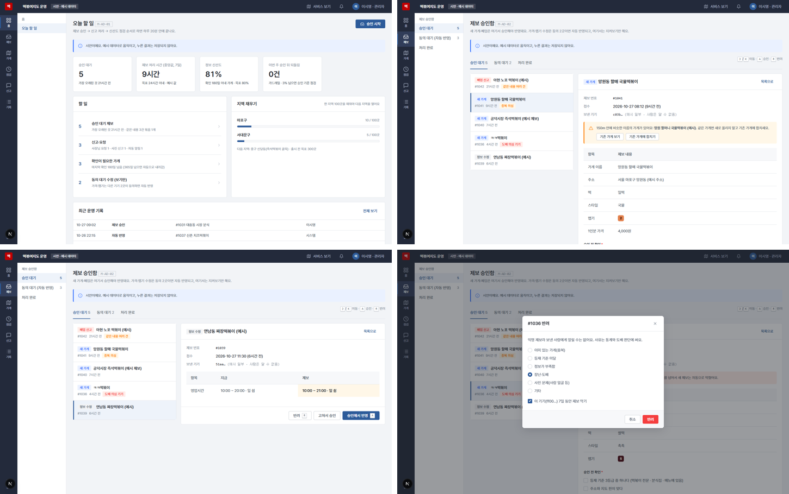
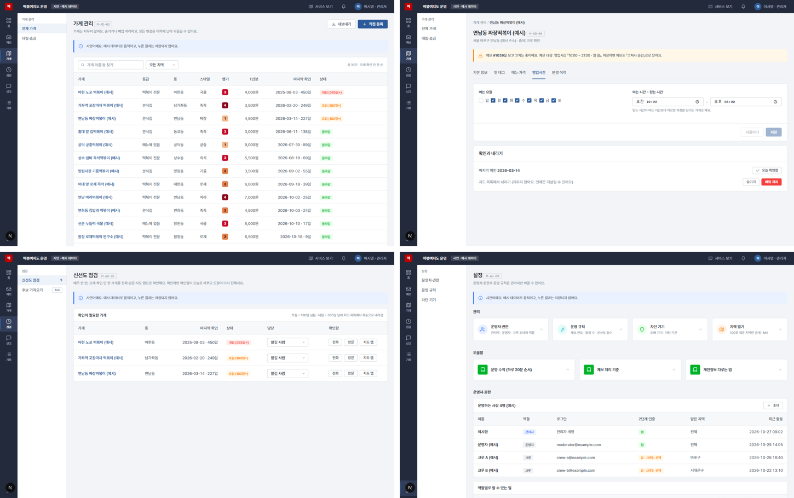
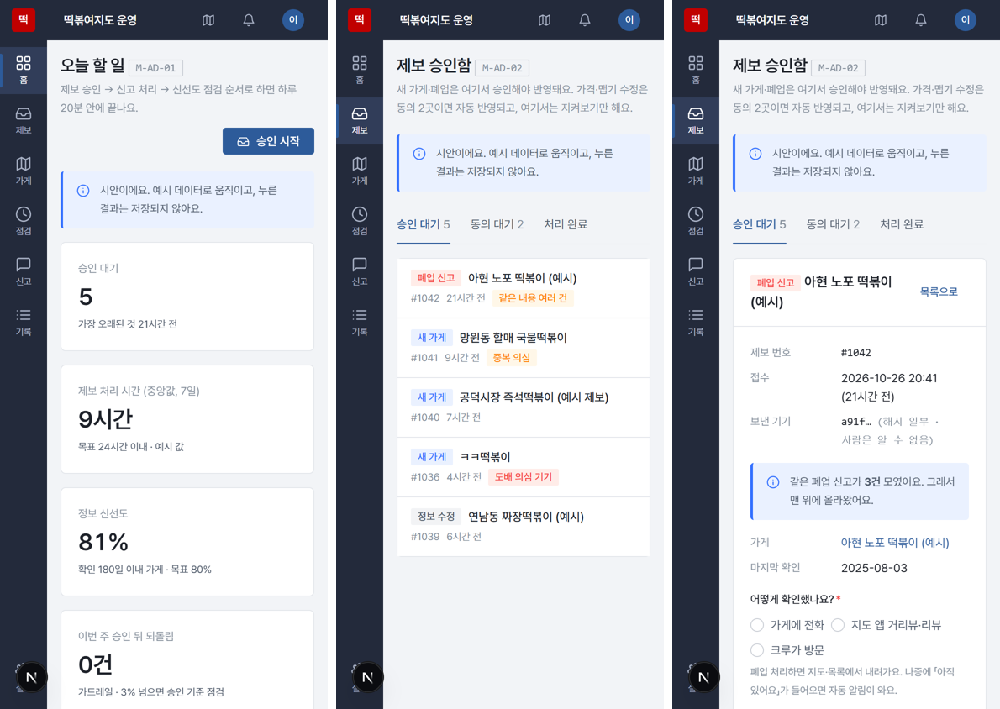

# 떡볶여지도 운영 어드민 기획 v1

| 항목 | 내용 |
| --- | --- |
| 문서 | 화면 기획서 (내부 운영 도구) |
| 버전 | v1 · 2026-10-27 |
| 기준 | 기획안 v4 (5·7·10·11·13절), 개발준비 v1 (8절 M3) |
| 시안 | `web/` 의 `/admin` (실행: `cd web && npm run dev` → http://localhost:3000/admin). 예시 데이터로 움직이고 저장은 안 됨 |
| DB 설계 | `web/supabase/migrations/20261027010000_admin.sql` (아직 적용 안 함) |
| 디자인 | Admin Navy (어두운 네이비 레일 + 흰 메뉴 + 밝은 회색 바탕), 주 색 = 서비스의 쪽빛 #2D5B9A |

### 버전 기록

| 버전 | 날짜 | 무엇을 | 영향 화면 |
| --- | --- | --- | --- |
| v1 | 2026-10-27 | 첫 기획 + 화면 시안 10개 + DB 설계 | M-AD-00 ~ M-AD-09 |

### 결정 기록 (ADR)

| ID | 결정 | 다른 선택지 | 왜 |
| --- | --- | --- | --- |
| ADR-01 | 어드민을 **같은 웹앱 안 `/admin`** 에 둔다 | 따로 앱 / Supabase 관리 화면 / Retool 같은 도구 | 코드·배포가 하나다. 태그 체계(taxonomy)를 서비스와 같이 쓴다. 돈이 안 든다. Supabase 관리 화면은 비상용으로만 쓴다 |
| ADR-02 | 디자인은 서비스(한지)와 다르게 **Admin Navy** | 서비스 디자인 그대로 | 운영은 한 화면에 많이 보여야 빠르다. 서비스 화면과 헷갈리지 않아 실수가 줄어든다. 주 색만 쪽빛으로 맞췄다 |
| ADR-03 | 가게는 **지우지 않고** 숨김·폐업 + 되살리기 | 지우기 | 잘못 내린 가게를 되살릴 수 있다. 변경 이력으로 무엇이든 되돌린다 |
| ADR-04 | 가격·맵기 수정은 **동의 2곳이면 자동 반영**, 어드민은 지켜보기만 | 전부 운영자 승인 | 기획안 7절 규칙이다. 운영자 손이 가장 많이 가는 일을 덜어 하루 20분을 지킨다 |
| ADR-05 | 승인함을 **휴대폰에서도** 쓰게 만든다 | 컴퓨터 전용 | 1인 운영이라 오가는 길에 처리할 수 있어야 쌓이지 않는다 |
| ADR-06 | **크루가 고친 가게 정보는 바로 반영**하고 기록에 남긴다 | 크루 수정도 운영자 승인 | 처음 크루 10명은 믿을 수 있는 사람이고 속도가 중요하다. 문제가 생기면 승인제로 바꾼다. **[확인필요] 사용자 결정** |
| ADR-07 | 승인·반려는 **DB 함수 하나로 「바꾸기 + 기록」을 한 번에** 한다 | 화면에서 두 번 저장 | 반만 처리되는 일이 없다. 두 사람이 같은 제보를 동시에 처리하는 것도 막는다 |

---

## 0.5 한 장 요약

- **문제:** 익명 제보로 채우는 지도는 운영자가 제보를 빨리 승인하고, 오래된 정보를 걸러야 믿을 수 있다. 지금은 그 일을 할 화면이 없다.
- **해결:** `/admin` 운영 어드민. 「오늘 할 일」 → 제보 승인함(키보드 A·R·J·K) → 신고·요청 → 신선도 점검 순서로, **1인이 하루 20분** 안에 끝내게 만든다.
- **핵심 지표:** 제보 처리 시간 중앙값 **24시간 이내**(KPI-AD-01). 이 지표가 서비스의 정보 신선도 80%와 월 승인 제보 1,000건을 받친다.
- **범위(M3):** 로그인·역할, 홈, 승인함, 가게 목록·편집·숨김·폐업, 신선도 점검, 신고·요청, 운영 기록, 설정(운영자·규칙·차단). 후보 가져오기는 M4, 사장님 센터는 3차.
- **일정:** M2(진짜 DB·로그인)를 붙인 직후. 관리자 혼자 1주 → 운영자 1명·크루 2명과 2주 시험 → 출시.
- **위험:** 1인 운영이 지침, 잘못된 폐업 처리, 계정 탈취. → 우선순위 정렬과 자동 반영, 되살리기와 자동 알림, 2단계 인증과 최소 권한으로 막는다.



---

## 1. 문제 정의

### 1.1 문제와 사용자

**문제:** 떡볶여지도의 가치는 「최신이고 맞는 정보」인데, 정보는 익명 제보로 들어온다. 운영자가 제보를 늦게 보거나 잘못 승인하면 지도가 틀리고, 「틀린 지도」라는 인상은 되돌리기 어렵다(기획안 13절: 가장 큰 위험 = 비어 있거나 틀린 지도).

| 사용자 | 언제 | 하려는 일 | 지금 막히는 것 |
| --- | --- | --- | --- |
| 관리자 (사용자 본인) | 매일 아침 20분, 이동 중 휴대폰 | 제보 승인, 신고 처리, 운영자·규칙 관리 | 처리할 화면이 없다. DB를 직접 고치면 느리고 실수하며 기록이 안 남는다 |
| 운영자 (나중에 1~2명) | 관리자 대신 하루 한 번 | 제보 승인·반려, 가게 수정 | 무엇을 먼저 할지, 기준이 무엇인지 모른다 |
| 크루 (처음 10명) | 동네를 돌거나 전화할 때 | 맡은 가게 확인, 맛 태그 채우기 | 무엇을 확인해야 하는지 목록이 없다 |

사장님은 어드민을 쓰지 않는다. 사장님 수정 요청은 「신고·요청」으로 들어오고, 사장님이 직접 고치는 화면은 3차 「사장님 센터」다(기획안 5절).

**근거:** 거지맵 이용자는 「직접 고칠 수 있다」를 칭찬하고 「폐업·가격이 늦게 반영된다」를 지적한다(기획안 2절). 처리 속도와 신선도가 곧 신뢰다. 운영자 인터뷰는 아직 없다. 베타 운영 2주 동안 처리 기록으로 확인한다.

### 1.2 가설과 지표

**가설:** 제보를 「같은 내용 3건 → 폐업 → 새 가게 → 수정」 순서로 정렬하고, 가격·맵기는 자동 반영하고, 키보드로 한 건 30초~1분에 처리하게 만들면, 1인이 하루 20분 안에 모든 제보를 24시간 안에 처리할 수 있다.

**처리량 어림:** 월 승인 제보 목표 1,000건이면 하루 약 33건이 들어온다. 가격·맵기 자동 반영이 40%라고 가정하면 운영자가 볼 것은 하루 약 20건이고, 건당 30초~1분이면 10~20분이다. 가정은 베타에서 확인한다.

| ID | 지표 | 정의 | 지금 | 목표 |
| --- | --- | --- | --- | --- |
| **KPI-AD-01 (북극성)** | 제보 처리 시간 | 접수부터 승인·반려까지 걸린 시간의 중앙값 (7일) | 없음 (출시 전) | 24시간 이내 |
| KPI-AD-02 | 하루 운영 시간 | 어드민에 머문 시간 (하루 합계) | 없음 | 20분 이하 |
| KPI-AD-03 | 정보 신선도 | 마지막 확인 180일 이내 가게 비율 (서비스와 같은 지표) | 예시 81% | 80% 이상 |
| KPI-AD-04 | 신고 처리 시간 | 신고·요청 접수부터 처리 완료까지 | 없음 | 48시간 이내 |
| 가드레일 G-1 | 승인 뒤 되돌림 | 승인하고 7일 안에 되돌린 비율 | 없음 | 3% 이하 |
| 가드레일 G-2 | 잘못된 폐업 | 폐업 처리 뒤 「아직 있어요」가 들어온 가게 수 | 없음 | 월 0~1건 |
| 가드레일 G-3 | 권한 밖 처리 | 역할에 없는 일을 시도해서 막힌 횟수 | 없음 | 0 (있으면 화면 점검) |

**지표 나무**

```
[입력]                                         [북극성]              [서비스로]
큐 정렬(우선 항목 먼저)        ─┐
가격·맵기 자동 반영 비율        ─┼─→ 제보 처리 시간 ≤ 24h ─┬─→ 월 승인 제보 1,000건
한 건 처리 시간(키보드·휴대폰)  ─┘   (KPI-AD-01)          └─→ 정보 신선도 80% (KPI-AD-03)
주 1회 신선도 점검·크루 맡기기 ────────────────────────────────→ 정보 신선도 80%
                                                                  └─→ 필터 → 길찾기 15% (서비스 기준 지표)
```

### 1.3 범위와 우선순위

**들어감 (M3):** 로그인·역할, 홈, 승인함, 가게 목록·편집·숨김·폐업·되살리기, 신선도 점검, 신고·요청, 운영 기록, 설정(운영자·규칙 보기·차단).

**빠짐 (Spec Out):** 사장님 센터(3차, 사장님 인증이 먼저 필요), 운영 리포트·통계 화면(지표는 처음에 Vercel·GA4로 본다), 메일·푸시 알림(1인 운영이라 홈 화면 숫자로 충분), 운영 규칙을 화면에서 바꾸기(처음엔 코드 값, 바꿀 일이 잦아지면 연다).

**우선순위 (MoSCoW: Must만으로 M3를 출시한다)**

| 구분 | 기능 | 왜 |
| --- | --- | --- |
| Must | 로그인 + 역할 확인 | 없으면 누구나 지도를 고칠 수 있다 |
| Must | 제보 승인함 (새 가게·수정·폐업) | 서비스가 돌아가는 심장. 없으면 제보가 반영되지 않는다 |
| Must | 가게 편집·숨김·폐업·되살리기 + 변경 이력 | 잘못된 정보를 고치고 되돌린다 |
| Must | 운영 기록 | 누가 무엇을 바꿨는지 모르면 실수와 악용을 못 찾는다 |
| Must | 신선도 점검 목록 | 신선도 80% 목표의 유일한 수단 |
| Must | 신고·요청함 | 사장님 항의 창구를 출시부터 열기로 했다(기획안 13절) |
| Must | 홈 「오늘 할 일」 | 무엇부터 할지 알려 줘야 20분 안에 끝난다 |
| Should | 키보드 처리 (A·R·J·K) · 휴대폰 승인함 | 처리 시간 북극성에 직접 영향 |
| Should | 기기 차단 (수동) | 자동 한도(하루 10건)를 피한 도배 대응 |
| Should | 동의 대기 지켜보기 · 막기 | 자동 반영의 안전장치 |
| Could | 크루에게 맡기기 · 내보내기 · 규칙 화면에서 바꾸기 | 크루가 늘면 필요 |
| Won't (지금) | 사장님 센터 · 통계 리포트 · 알림 | 위 「빠짐」 참고 |

**로드맵:** Now = M3 (위 Must + Should) · Next = M4 후보 가져오기(M-AD-06) + 크루 계정·맡기기 · Later = 사장님 센터, 운영 리포트, 알림.

---

## 2. 요구사항

### 2.1 정책표

영향 범위: **MW** 서비스 화면 · **AD** 어드민 · **UMS** 알림 · **DB** DB·서버

| ID | 정책 | 규칙 | MW | AD | UMS | DB |
| --- | --- | --- | :-: | :-: | :-: | :-: |
| REQ-AD-01 | 들어오기 | • `/admin` 은 로그인한 운영하는 사람만 들어온다. 아니면 `/admin/login`<br>• 이메일 로그인 링크(비밀번호 없음) + 2단계 인증. 관리자·운영자는 2단계 인증 필수, 크루는 선택<br>• 가입 화면 없음. 관리자가 초대한다<br>• 로그인 유지 12시간<br>• 검색엔진 차단(robots, noindex)<br>• 역할 확인은 **서버와 DB가** 한다. 화면에서 버튼을 숨기는 것만으로 막지 않는다 | | V | V | V |
| REQ-AD-02 | 역할 | • 관리자: 전부 + 운영자 초대·역할 + 규칙<br>• 운영자: 제보·가게·신고·차단·후보, 운영 기록 보기<br>• 크루: 가게 수정, 신선도 확인(맡은 것). 제보 승인·숨김·폐업은 못 함<br>• 표는 M-AD-09 「역할별로 할 수 있는 일」 | | V | | V |
| REQ-AD-03 | 승인함 순서 | • 같은 내용 3건 이상 → 폐업 신고 → 새 가게 → 정보 수정<br>• 같은 칸에서는 오래된 것부터<br>• 같은 내용은 한 줄로 묶고 건수를 보인다 | | V | | V |
| REQ-AD-04 | 새 가게 승인 | • 확인 4개를 모두 체크해야 승인 버튼이 켜진다: 등재 기준 3등급 / 주소와 핀 / 중복 아님(150m 안 비슷한 이름) / 사진에 얼굴·개인 정보 없음<br>• 중복 의심이면 경고와 함께 「기존 가게에 합치기」<br>• 승인하면 가게 생성, 확인일 = 오늘, 출처 = 제보<br>• 「고쳐서 승인」 = 값을 고친 뒤 승인 | V | V | | V |
| REQ-AD-05 | 정보 수정 | • 가격·맵기: 다른 기기 2곳이 동의하면 자동 반영(기획안 7절). 어드민은 「동의 대기」에서 지켜보고 「막기」로 멈출 수 있다<br>• 그 밖의 항목(떡·스타일·영업시간·주소): 운영자 승인. 「지금 값 ↔ 제보 값」을 나란히 보이고 바뀐 칸을 칠한다 | V | V | | V |
| REQ-AD-06 | 폐업 신고 | • 확인 방법(전화 / 지도 앱 / 크루 방문)을 골라야 처리된다<br>• 폐업 처리하면 지도·목록에서 내려간다. 지우지 않는다<br>• 폐업 뒤 「아직 있어요」가 들어오면 자동 알림(M-AD-07) → 되살리기 검토 | V | V | | V |
| REQ-AD-07 | 반려 | • 사유를 골라야 반려된다: 중복 / 등재 기준 미달 / 정보 부족 / 장난·도배 / 사진 문제 / 기타<br>• 익명이라 보낸 사람에게 알리지 않는다. 사유는 통계와 도배 판단에 쓴다<br>• 「장난·도배」면 그 기기 7일 차단을 바로 고를 수 있다 | | V | | V |
| REQ-AD-08 | 도배 막기 | • 서버: 기기·IP 해시 기준 하루 10건을 넘으면 자동 차단 + 승인함에 「도배 의심 기기」 표시<br>• 어드민: 수동 차단(7일 / 30일 / 계속), 풀기. 차단 목록은 M-AD-09 | V | V | | V |
| REQ-AD-09 | 가게 편집 | • 태그는 정해진 보기에서만 고른다(taxonomy.ts). 맛 결은 최대 2개<br>• 저장하면 변경 이력(이전 값 → 새 값, 누가, 언제) + 운영 기록<br>• 이력의 한 줄 「되돌리기」, 되돌린 것도 기록<br>• 숨기기(이유 필수) / 폐업 처리 / 되살리기. 지우기 없음<br>• 「오늘 확인함」 = 확인일을 오늘로 | V | V | | V |
| REQ-AD-10 | 신선도 | • 마지막 확인 180일 넘은 가게를 오래된 순으로(흐림), 365일 넘으면 「내림」(서비스에서 자동으로 빠짐)<br>• 확인 방법(전화·방문·지도 앱)을 누르면 확인일이 오늘<br>• 크루에게 맡기기. 크루는 자기에게 맡겨진 것만 본다 | V | V | | V |
| REQ-AD-11 | 신고·요청 | • 종류: 사장님 요청 / 정보 신고 / 사진 신고 / 자동 알림<br>• 48시간 안에 처리, 넘으면 빨간 표시<br>• 사장님 요청도 노출 순서·태그를 바꾸는 근거가 되지 않는다(기획안 10절). 사실 정보만 고친다<br>• 사장님 연락처는 꼭 필요할 때만 받고, 처리 뒤 30일에 지운다 **[확인필요]** | V | V | | V |
| REQ-AD-12 | 운영 기록 | • 승인·반려·수정·숨김·폐업·되살리기·차단·역할 변경을 모두 남긴다<br>• 아무도 고치거나 지울 수 없다(DB가 막음)<br>• 보관 기간 **[확인필요]** (제안: 3년) | | V | | V |
| REQ-AD-13 | 개인정보 | • 제보자는 기기·IP **해시만** 저장, 화면에는 앞 4자리만<br>• IP 원문은 저장하지 않는다<br>• 사진 속 얼굴·차 번호판이 보이면 반려 또는 사진만 내린다 | | V | | V |
| REQ-AD-14 | 후보 가져오기 (M4) | • 공공데이터포털 일반음식점 인허가에서 업태 「분식」 또는 이름에 「떡볶이」, 영업 중만 고른다<br>• 이름 + 150m로 이미 있는 가게를 찾아 「이미 있음」<br>• 크루가 확인한 것만 등록한다. 포털 리뷰·사진은 가져오지 않는다(저작권·약관) | | V | | V |
| REQ-AD-15 | 홈 | • 오늘 할 일 4가지(승인 대기 · 신고·요청 · 확인 필요 · 동의 대기)를 숫자로, 누르면 그 화면<br>• 지표 카드 4개, 지역 채우기(100곳 관문), 최근 운영 기록 5줄 | | V | | |
| REQ-AD-16 | 빠른 처리 | • 승인함 키보드: J/K 아래·위, A 승인, R 반려. 입력칸에 있을 때는 동작하지 않는다<br>• 처리하면 다음 제보가 바로 열린다<br>• 1000px보다 좁으면 목록 → 상세 → 「목록으로」 한 화면씩 | | V | | |

### 2.2 흐름

**제보 처리 (M-AD-02)**

```
[제보 접수 (서비스 제보하기)]
  → (하루 10건 넘은 기기?)
       ├ Yes → 자동 차단 + 승인함에 「도배 의심 기기」 → M-AD-02 (반려 + 차단)
       └ No  → (종류?)
  → 가격·맵기 수정 → 「동의 대기」
       → (다른 기기 2곳 동의?)
            ├ Yes → 자동 반영 + 운영 기록(시스템) → 「처리 완료: 자동 반영」
            └ No  → 기다림. 운영자가 「막기」 → 승인 대기로 / 「지금 반영」 → 반영
  → 새 가게 / 그 밖의 수정 / 폐업 → 「승인 대기」 (REQ-AD-03 순서)
       → 운영자가 연다 (J 또는 누르기)
       → (새 가게?) → 확인 4개 → (중복 의심?)
              ├ Yes → 경고창#3 → 「기존 가게에 합치기」(반려: 중복) / 「그래도 새로」
              └ No  → 승인 → 가게 생성 → 서비스 지도에 올라감
       → (폐업?) → 확인 방법 고르기 → 폐업 처리 → 지도에서 내림
       → (수정?) → 지금 ↔ 제보 비교 → 승인 / 고쳐서 승인 → M-AD-04
       → (반려?) → 경고창#4(사유 필수) → 반려 (+ 기기 차단)
       → (다른 운영자가 이미 처리?) → 경고창#2 → 목록 새로 고침
  → 처리 끝 → 다음 제보가 열림 → (남은 게 없음?) → 「오늘 할 일 끝!」
[끝]
```

**신선도 (M-AD-05)**

```
[매일 자동] 확인일 180일 넘음 → 서비스: 흐린 도장 · 어드민: 신선도 점검에 올라옴
           확인일 365일 넘음 → 서비스: 지도·목록에서 내림 · 어드민: 「내림」 표시
[주 1회]   운영자: 오래된 순으로 → (직접?) ├ 전화·지도 앱 → 확인함 → 확인일 = 오늘
                                         └ 크루에게 맡기기 → 크루가 방문 → 확인함
           (문 닫음?) → 가게 편집 → 폐업 처리 (REQ-AD-06)
```

### 2.3 인수 기준과 비기능 요건

| AC | 요구 | 주어진 상황 | 할 때 | 그러면 |
| --- | --- | --- | --- | --- |
| AC-01 | REQ-AD-01 | 로그인 안 한 사람 | `/admin/reports` 를 열면 | `/admin/login` 으로 간다 |
| AC-02 | REQ-AD-02 | 크루로 로그인 | 승인 API를 직접 부르면 | DB가 「권한이 없어요」로 막고 G-3에 남는다 |
| AC-03 | REQ-AD-03 | 같은 폐업 신고 3건과 새 가게 1건 | 승인함을 열면 | 폐업 신고 묶음이 맨 위에 있다 |
| AC-04 | REQ-AD-04 | 새 가게 제보, 확인 3개만 체크 | 승인을 누르면 | 버튼이 꺼져 있고 처리되지 않는다 |
| AC-05 | REQ-AD-05 | 맵기 수정 제보, 동의 1곳 | 다른 기기가 동의하면 | 자동 반영되고 기록에 「시스템」으로 남는다 |
| AC-06 | REQ-AD-06 | 폐업 처리된 가게 | 200m 안에서 「아직 있어요」가 들어오면 | 신고·요청에 자동 알림이 생긴다 |
| AC-07 | REQ-AD-07 | 반려 창 | 사유를 안 고르면 | 반려 버튼이 꺼져 있다 |
| AC-08 | REQ-AD-09 | 가게 가격 수정 후 저장 | 변경 이력의 「되돌리기」를 누르면 | 이전 값으로 돌아가고 되돌린 것도 기록된다 |
| AC-09 | REQ-AD-12 | 누구든 | 운영 기록을 고치거나 지우려 하면 | DB가 막는다 |
| AC-10 | ADR-07 | 두 운영자가 같은 제보를 연 상태 | 한 명이 먼저 승인하고 다른 한 명이 승인하면 | 두 번째는 「이미 처리된 제보예요」(경고창#2) |
| AC-11 | REQ-AD-16 | 승인함, 입력칸에 커서 없음 | A 를 누르면 | 지금 제보가 승인되고 다음 제보가 열린다 |

**비기능 요건**

- **보안:** 관리자·운영자는 2단계 인증 필수. 역할 확인은 서버(route handler·서버 함수)와 DB(RLS)가 이중으로 한다. 서버 전용 키는 브라우저에 보내지 않는다. `/admin` 은 검색엔진에서 막는다.
- **개인정보:** REQ-AD-13. 사장님 연락처는 운영자 이상만 본다.
- **기록:** 모든 쓰기는 같은 DB 처리 안에서 운영 기록을 남긴다(ADR-07).
- **성능:** 승인함 첫 화면 1초 안. 목록은 50건씩.
- **접근성:** 키보드만으로 승인·반려까지 할 수 있다. 글자 대비는 Admin Navy 기본값을 지킨다.
- **화면:** 1200 / 900 / 600px에서 깨지지 않는다. 휴대폰(390px)에서 승인함을 쓸 수 있다.
- **백업:** Supabase 무료 플랜의 백업 범위 **[확인필요]**. 출시 전 Pro(월 25달러) 전환을 검토한다.
- **비상시:** 어드민이 고장 나면 Supabase 관리 화면으로 처리하고, 운영 기록을 손으로 남긴다.

### 2.4 측정 계획

| 이벤트 | 화면 | 속성 | 지표 |
| --- | --- | --- | --- |
| admin_report_decide | M-AD-02 | kind, decision(approve/reject/merge/close), age_hours(접수부터), seconds_open(열어 본 시간), via_keyboard | KPI-AD-01, KPI-AD-02 |
| admin_report_auto | (서버) | kind, agreements | 자동 반영 비율 (입력 지표) |
| admin_report_hold | M-AD-02 | report_id | G-1 참고 |
| admin_store_save | M-AD-04 | changed_fields, from_report | — |
| admin_store_revert | M-AD-04 | field, days_since_change | G-1 |
| admin_store_close / revive | M-AD-04 | method | G-2 |
| admin_freshness_confirm | M-AD-05 | method(phone/visit/map), days_stale, by_role | KPI-AD-03 |
| admin_flag_done | M-AD-07 | kind, age_hours | KPI-AD-04 |
| admin_session | 전체 | minutes, role | KPI-AD-02 |
| admin_denied | (서버) | action, role | G-3 |

운영 기록(audit_logs)에 대부분의 사실이 남으므로, 처음에는 운영 기록을 세는 것으로 지표를 낸다. 화면 머문 시간만 따로 잰다.

### 2.5 실험

해당 없음. 쓰는 사람이 1~3명이라 A/B 시험이 안 된다. 대신 베타 2주의 처리 시간을 기준선으로 두고, 정렬 규칙·자동 반영 비율을 바꿀 때마다 앞뒤를 비교해 기록한다.

### 2.6 의존성과 역할 (RACI)

| 일 | 관리자(사용자) | Claude(개발) | 운영자·크루 | 외부 |
| --- | --- | --- | --- | --- |
| ADR-06 크루 즉시 반영 결정 · 보관 기간 · 연락처 수집 결정 | A·R | C | I | |
| Supabase 프로젝트·로그인 메일 설정 (M2) | A·R | C | | Supabase |
| 어드민 개발 (M3) | A | R | C | |
| 운영 수칙·제보 처리 기준 문서 | A | R(초안) | C | |
| 운영자·크루 초대와 교육 | A·R | C | I | |
| 베타 운영 2주 | A | C | R | |

**먼저 끝나야 하는 것:** M2(진짜 DB·로그인)가 먼저다. 로그인 링크 메일은 Supabase 기본 메일의 발송 한도가 낮아서, 운영자가 늘면 따로 메일 발송 설정이 필요하다 **[확인필요]**. 주소 검색(도로명주소 API)이 붙어야 「주소와 핀이 맞다」를 쉽게 확인한다.

**크기 어림 (1인 개발):** 로그인·역할·셸 S · 승인함 L · 가게 편집·이력·되돌리기 M · 신선도·신고·기록·설정 각 S · DB 함수·권한 M. 기간은 정하지 않는다(개발준비 8절과 같음).

### 2.7 위험과 가정

| ID | 위험 | 영향 | 가능성 | 대응 | 담당 |
| --- | --- | --- | --- | --- | --- |
| RISK-01 | 1인 운영이 지쳐서 제보가 쌓인다 | 높음 | 중간 | 큐 정렬·자동 반영·키보드·휴대폰(ADR-04·05). 하루 운영 시간(KPI-AD-02)이 30분을 넘으면 운영자를 늘린다 | 관리자 |
| RISK-02 | 열린 가게를 잘못 폐업 처리한다 | 높음 | 낮음 | 확인 방법 필수, 지우지 않음, 「아직 있어요」 자동 알림(G-2) | 운영자 |
| RISK-03 | 운영자 계정을 빼앗긴다 | 높음 | 낮음 | 2단계 인증, 최소 권한, 운영 기록, 한 번에 되돌리기 | 관리자 |
| RISK-04 | 크루가 실수로 정보를 망친다 | 중간 | 중간 | 변경 이력·되돌리기. 잦으면 크루 수정을 승인제로(ADR-06) | 관리자 |
| RISK-05 | 사장님 항의가 커진다 | 중간 | 중간 | 별점 없음, 48시간 처리, 사실 정보만 고친다는 기준 공개 | 운영자 |
| RISK-06 | 사장님 연락처 같은 개인정보가 샌다 | 높음 | 낮음 | 최소 수집, 운영자만 보기, 30일 뒤 삭제 [확인필요] | 관리자 |
| 가정 A-1 | 가격·맵기 자동 반영이 40% 안팎이다 | | | 베타 2주에 확인. 낮으면 처리량 어림을 다시 한다 | |
| 가정 A-2 | 한 건 처리는 30초~1분이다 | | | seconds_open 으로 확인 | |

---

## 3. 화면 기획

### 3.1 만들 화면 목록

| 화면 ID | 화면 | 주소 | 구분 | 단계 | 시안 |
| --- | --- | --- | --- | --- | --- |
| M-AD-00 | 운영 로그인 | `/admin/login` | 신설 | M3 | ✅ (모양만) |
| M-AD-01 | 홈 · 오늘 할 일 | `/admin` | 신설 | M3 | ✅ |
| M-AD-02 | 제보 승인함 (승인 대기 · 동의 대기 · 처리 완료) | `/admin/reports` | 신설 | M3 | ✅ 눌러서 처리 |
| M-AD-02-01 | └ 반려 창 | (창) | 신설 | M3 | ✅ |
| M-AD-03 | 가게 목록 | `/admin/stores` | 신설 | M3 | ✅ 찾기·지역 거르기 |
| M-AD-04 | 가게 편집 (기본 · 맛 태그 · 메뉴·가격 · 영업시간 · 변경 이력) | `/admin/stores/[id]` | 신설 | M3 | ✅ |
| M-AD-04-01 | └ 숨기기 · 폐업 처리 확인 창 | (창) | 신설 | M3 | ✅ |
| M-AD-05 | 신선도 점검 | `/admin/freshness` | 신설 | M3 | ✅ 확인함·맡기기 |
| M-AD-06 | 후보 가져오기 | `/admin/candidates` | 신설 | **M4** | ✅ (흐름만) |
| M-AD-07 | 신고·요청 | `/admin/flags` | 신설 | M3 | ✅ 처리 완료 |
| M-AD-08 | 운영 기록 | `/admin/logs` | 신설 | M3 | ✅ |
| M-AD-09 | 설정 (운영자·권한 · 운영 규칙 · 차단 기기) | `/admin/settings` | 신설 | M3 | ✅ |
| — | 서비스: 제보하기 (기존) | `/report` | 수정 | M2 | 제보가 `reports` 에 저장되게 |
| — | 서비스: 가게 상세 「아직 있어요」 (기존) | `/store/[id]` | 수정 | M2 | `confirmations` 저장 + 폐업 가게면 알림 |

### 3.2 화면 틀

모든 어드민 화면은 같은 틀이다.

```
┌──────┬─────────────────────────────────────────────────────┐
│ [떡] │ 떡볶여지도 운영 [시안]          서비스 보기 · 알림 · 이시영 │  ← 네이비 헤더
├──────┼──────────┬──────────────────────────────────────────┤
│ 홈   │ 보조 메뉴 │ 화면 제목 [M-AD-xx]                [주 버튼] │
│ 제보 │ (선택한  │ 설명 한 줄                                 │
│ 가게 │  칸의    │ ─────────────────────────────────────────  │
│ 점검 │  하위    │ 내용 (카드 · 표 · 폼)                        │
│ 신고 │  메뉴)   │                                            │
│ 기록 │          │                                            │
│ 설정 │          │                                            │
└──────┴──────────┴──────────────────────────────────────────┘
  레일 64px   메뉴 180px   내용 (회색 바탕, 카드는 흰색)
  900px보다 좁으면 보조 메뉴를 숨긴다. 600px보다 좁으면 레일을 56px로 줄인다.
```





### 3.3 화면별 상세

번호마다 ① 무엇을 보이나 ② 누르면 ③ 어디로 ④ 예외 ⑤ 근거 순으로 적었다.

#### M-AD-00 운영 로그인 · `/admin/login`

1. **이메일:** 초대받은 이메일을 넣고 「로그인 링크 받기」 → 메일의 링크 → 2단계 인증. 초대 안 된 이메일이면 「초대받은 이메일이 아니에요」. (REQ-AD-01)
2. **2단계 인증:** 인증 앱 6자리. 5번 틀리면 15분 잠금 **[확인필요]**.
3. **들어간 뒤:** 원래 열려던 화면으로. 없으면 M-AD-01.
- 예외: 경고창#7 로그인 만료 → 이 화면으로, 작업 중이던 입력은 브라우저에 임시 저장.

#### M-AD-01 홈 · 오늘 할 일 · `/admin`

1. **주 버튼 「승인 시작」:** → M-AD-02 (승인 대기 첫 제보).
2. **지표 카드 4개:** 승인 대기 수와 가장 오래된 것 / 제보 처리 시간 중앙값 (KPI-AD-01) / 정보 신선도 (KPI-AD-03) / 이번 주 승인 뒤 되돌림 (G-1).
3. **할 일:** 승인 대기 → M-AD-02 · 신고·요청 → M-AD-07 · 확인이 필요한 가게 → M-AD-05 · 동의 대기 → M-AD-02 동의 대기 탭. 0건이면 그 줄을 흐리게.
4. **지역 채우기:** 구마다 「n / 100곳」 막대. 100곳을 넘으면 「다음 지역 열 수 있음」 표시. (기획안 11절)
5. **최근 운영 기록:** 5줄 → 「전체 보기」 M-AD-08.
- 예외: 경고창#8 할 일이 모두 0 → 「오늘 할 일 끝!」.

#### M-AD-02 제보 승인함 · `/admin/reports` (문서의 중심)

1. **탭:** 승인 대기 / 동의 대기 / 처리 완료. 탭 옆에 건수. 주소 `?tab=agree`·`?tab=done` 으로 바로 열린다. 오른쪽에 키보드 안내(600px보다 좁으면 숨김).
2. **목록 (왼쪽):**
   - 2-1 한 줄 = 종류 배지(폐업 빨강 · 새 가게 파랑 · 수정 회색) + 가게 이름 + 번호 · 몇 시간 전 + 경고 배지(같은 내용 여러 건 / 중복 의심 / 도배 의심 기기 / 주소와 핀이 멂).
   - 2-2 순서 = REQ-AD-03. 처리 완료 탭은 최근 것부터.
   - 2-3 누르면 오른쪽 상세. J/K로 위아래.
   - 예외: 비었으면 「오늘 할 일 끝!」 + 「신고·요청 보기」 버튼 (경고창#8).
3. **상세 (오른쪽):**
   - 3-1 머리: 종류 + 이름 + 「목록으로」(좁은 화면에서 목록으로 돌아감).
   - 3-2 기본: 제보 번호, 접수 시각, 보낸 기기(해시 앞 4자리, REQ-AD-13), 사진 유무, 처리한 사람·반려 사유(처리 완료일 때).
   - 3-3 경고:
     - 같은 내용 n건 → 안내.
     - 중복 의심 → 경고창#3: 「기존 가게 보기」 → M-AD-04 / 「기존 가게에 합치기」 → 반려(사유 중복) 처리.
     - 도배 의심 기기 → 빨간 경고 「오늘 n건, 자동 차단됨」.
   - 3-4 내용:
     - 새 가게 = 제보 내용 표 + 확인 4개 체크 (REQ-AD-04).
     - 정보 수정 = 「지금 ↔ 제보」 표, 바뀐 칸 노랑 (REQ-AD-05).
     - 폐업 = 가게·마지막 확인일 + 확인 방법 고르기 (REQ-AD-06).
     - 동의 대기 = 「n/2」 안내. 자동 반영됨 = 초록 안내 + 「변경 이력에서 되돌리기」.
4. **버튼 (아래, 오른쪽 정렬):**
   - 승인 대기: 「반려 R」 → M-AD-02-01 / 「고쳐서 승인」 → M-AD-04 `?from=제보번호` / 주 버튼 「승인하고 지도에 올리기 · 승인해서 반영 · 폐업 처리 A」(조건이 안 맞으면 꺼짐).
   - 동의 대기: 「막기 (승인 대기로)」 / 「지금 반영」.
   - 처리하면 아래쪽 알림 「… · 운영 기록에 남았어요」, 다음 제보가 열린다.
   - 예외: 경고창#2(이미 처리됨), 경고창#6(저장 실패 · 오프라인).

#### M-AD-02-01 반려 창

1. 안내: 익명이라 알릴 수 없고, 사유는 통계·도배 판단용.
2. 사유 하나 고르기 (REQ-AD-07). 도배 기기에서 연 경우 「장난·도배」가 미리 골라짐.
3. 「장난·도배」면 「이 기기 7일 동안 제보 막기」 체크 (REQ-AD-08).
4. 「반려」(빨강, 사유 없으면 꺼짐 = 경고창#4) / 「취소」.

#### M-AD-03 가게 목록 · `/admin/stores`

1. **위 버튼:** 내보내기(표 파일) / 주 버튼 「직접 등록」 → M-AD-04 빈 화면.
2. **툴바:** 이름·동 찾기, 지역 고르기, 총 n곳.
3. **표:** 가게(누르면 M-AD-04) · 등급 · 동 · 스타일 · 맵기 도장 · 1인분 · 마지막 확인(며칠) · 상태(올라감 / 흐림 180일+ / 내림 365일+ / 숨김 / 폐업). 기본 순서는 오래 확인 안 한 순.
4. **줄 끝 (마우스를 올리면):** 편집 → M-AD-04, 서비스 → 서비스 가게 상세(새 탭).
5. **보조 메뉴 「내림·숨김」:** `?view=hidden` → 내려간 가게만 (되살리기용).
- 예외: 찾는 가게가 없으면 빈 화면 안내.

#### M-AD-04 가게 편집 · `/admin/stores/[id]`

1. **경로·제목:** 가게 관리 / 가게 이름, 주소 · 출처.
2. **제보에서 왔을 때 (`?from=`):** 노란 안내 「제보 #n을 보고 고치는 중, 제보 내용 …, 저장하면 제보도 고쳐서 승인으로 닫힘」.
3. **탭:**
   - 기본 정보 = 이름 · 등재 등급 · 가게 유형 · 동 · 주소(M2부터 주소 검색) · 지도 핀(M3에서 끌어서 옮기기).
   - 맛 태그 = 떡(여러 개) · 스타일(하나) · 맵기 도장 1~5 · 맛 결(최대 2, 넘으면 나머지 꺼짐) · 같이 먹기 · 이용.
   - 메뉴·가격 = 메뉴판 표, 대표 1인분(필터 값), 가격 확인일.
   - 영업시간 = 여는 요일, 여는·닫는 시간(닫는 시간이 이르면 자정 넘김).
   - 변경 이력 = 언제 · 누가 · 무엇을 · 이전 → 새 값 · 「되돌리기」.
4. **저장 줄:** 바뀐 게 없으면 「되돌리기」·「저장」 꺼짐. 저장 → 이력 + 운영 기록 (REQ-AD-09).
5. **확인과 내리기 카드:** 「오늘 확인함」 → 확인일 = 오늘 / 「숨기기」 → M-AD-04-01(이유 필수) / 「폐업 처리」 → M-AD-04-01.
- 예외: 없는 가게 → 404(경고창#9), 저장 실패 → 경고창#6, 다른 사람이 먼저 고침 → 경고창#2(새로 불러오기).

#### M-AD-05 신선도 점검 · `/admin/freshness`

1. **표:** 마지막 확인 180일 넘은 가게, 오래된 순. 상태 = 흐림 (180일+) / 내림 (365일+).
2. **담당:** 크루 고르기 → 맡기기 (크루 화면에는 맡은 것만, REQ-AD-10).
3. **확인함:** 전화 / 방문 / 지도 앱 → 확인일 = 오늘, 줄이 사라짐, 알림.
4. **문 닫았으면:** 가게 이름 → M-AD-04 → 폐업 처리.
- 예외: 모두 180일 안 → 「모든 가게가 180일 안에 확인됐어요」.

#### M-AD-06 후보 가져오기 · `/admin/candidates` (M4)

1. **4단계 안내:** 고르기(업태 분식 · 이름에 떡볶이 · 영업 중) → 겹침 찾기(이름 + 150m) → 크루 확인 → 등록.
2. **공공데이터 파일 올리기:** M4에서 연다(지금 꺼짐).
3. **후보 표:** 이름 · 주소 · 업태 · 상태(새 후보 / 확인 중 / 확인 끝 / 이미 있음 / 떡볶이 없음) · 담당 · 「크루에게 맡기기 / 등록 / 빼기」.
- 정책: REQ-AD-14. 포털 리뷰·사진을 가져오지 않는다.

#### M-AD-07 신고·요청 · `/admin/flags`

1. **종류 탭:** 전체 / 사장님 요청 / 정보 신고 / 사진 신고 / 자동 알림. 「처리한 것도 보기」.
2. **표:** 종류 배지 · 내용 · 가게(→ M-AD-04) · 접수(48시간 넘으면 빨간 배지).
3. **버튼:** 종류별 주 행동(가게 정보 고치기 / 사진 내리기 / 확인일 새로 고치기) → M-AD-04, 「처리 완료」.
- 자동 알림 예: 폐업·오래된 가게에 「아직 있어요」가 들어옴(경고창#10), 하루 한도를 넘은 기기(경고창#11).

#### M-AD-08 운영 기록 · `/admin/logs`

1. **툴바:** 가게·제보 번호·사람 찾기, 종류 고르기, 내려받기.
2. **표 (촘촘한 표):** 언제 · 누가(역할 배지, 시스템 = 자동) · 무엇을 · 대상 · 내용. 고치기·지우기 없음 (REQ-AD-12).

#### M-AD-09 설정 · `/admin/settings`

1. **관리 카드 4개:** 운영자·권한 / 운영 규칙 / 차단 기기 / 지역 열기(M4). 누르면 같은 화면의 해당 칸으로.
2. **도움말 카드 3개:** 운영 수칙(하루 20분 순서) · 제보 처리 기준 · 개인정보 다루는 법 → 문서(출시 준비 때 씀).
3. **운영자·권한:** 사람 표(이름 · 역할 · 로그인 · 2단계 인증 · 맡은 지역 · 최근 활동), 「초대」(관리자만) + 「역할별로 할 수 있는 일」 표 (REQ-AD-02).
4. **운영 규칙:** 하루 제보 한도 10건 · 동의 2곳 · 같은 내용 3건 · 흐림 180일 · 내림 365일 · 「아직 있어요」 200m. 지금은 읽기만.
5. **차단 기기:** 기기 · 이유 · 차단한 사람 · 풀리는 날 · 「풀기」.
- 예외: 운영자·크루가 열면 운영자·규칙 칸은 읽기만, 초대·풀기는 경고창#1.

### 예외·경고 모음

| No | 언제 | 버튼 | 결과 |
| --- | --- | --- | --- |
| 경고창#1 | 역할에 없는 일을 하려 함 | 확인 | 닫힘, 아무 일도 안 일어남 (G-3 기록) |
| 경고창#2 | 다른 운영자가 이미 처리한 제보·가게 | 새로 고침 | 최신 상태로 다시 불러옴 |
| 경고창#3 | 새 가게가 150m 안 비슷한 이름과 겹침 | 기존 가게 보기 / 기존 가게에 합치기 / 그래도 새로 | M-AD-04 / 반려(중복) / 확인 4개로 계속 |
| 경고창#4 | 반려 사유를 안 고름 | — | 반려 버튼 꺼짐 |
| 경고창#5 | 숨기기·폐업 처리 | 취소 / 숨기기·폐업 처리 | 닫힘 / 내려감(되살리기 가능) |
| 경고창#6 | 저장 실패 · 인터넷 끊김 | 다시 시도 | 입력은 그대로 두고 다시 보냄 |
| 경고창#7 | 로그인 만료 | 로그인 | M-AD-00, 입력은 임시 저장 |
| 경고창#8 | 할 일이 비었음 | 신고·요청 보기 | M-AD-07 |
| 경고창#9 | 없는 가게·제보 주소 | 목록으로 | M-AD-03 / M-AD-02 |
| 경고창#10 | 폐업·오래된 가게에 「아직 있어요」 | 확인일 새로 고치기 / 되살리기 | 확인일 = 오늘 / 다시 올림 |
| 경고창#11 | 한 기기가 하루 10건을 넘음 | 이 기기 제보 모두 반려 / 그대로 | 반려 + 차단 유지 |

---

## 4. 출시

```
단계 : 시안(지금) → M2 연결 → 관리자 혼자 1주 (베타 제보로) → 운영자 1명 + 크루 2명 2주 → 출시
켜고 끄기 : 크루 즉시 반영(ADR-06)은 설정 하나로 승인제로 바꿀 수 있게 만든다
시험 : 해당 없음 (2.5)
출시 준비 : 운영 수칙(하루 20분 순서) · 제보 처리 기준표 · 개인정보 다루는 법 · 크루 안내 · 비상시 Supabase 관리 화면 사용법
```

| 관문 | 기준 |
| --- | --- |
| 출시 가능 | 베타 2주 동안 제보 처리 시간 중앙값 24시간 이내 · 하루 운영 20분 이하 · 권한 시험(크루가 승인 못 함, AC-02) 통과 · 운영 기록 빠짐 0 |
| 되돌리기 | 어드민 오류로 잘못된 처리가 생기면 어드민 쓰기를 멈추고 Supabase 관리 화면으로 처리한다. 운영 기록으로 원인을 찾아 되돌린다 |

---

## 5. 정할 것과 미결

| No | 내용 | 상태 | 담당 |
| --- | --- | --- | --- |
| I-01 | 크루가 고친 정보를 바로 반영할지, 운영자 승인을 거칠지 (ADR-06, 제안 = 바로 반영 + 기록) | 결정 대기 | 사용자 |
| I-02 | 운영 기록 보관 기간 (제안 = 3년) | 결정 대기 | 사용자 |
| I-03 | 사장님 연락처를 받을지, 받으면 처리 뒤 30일에 지울지 | 결정 대기 | 사용자 |
| I-04 | 처음 운영 인원 (관리자 혼자 시작? 운영자 몇 명?) | 결정 대기 | 사용자 |
| I-05 | 2단계 인증 방식 (인증 앱 / 문자) · 잠금 규칙 | 개발 협의 | Claude |
| I-06 | 로그인 메일 발송 방식 (Supabase 기본은 한도가 낮음) | 확인 필요 | Claude |
| I-07 | Supabase 무료 플랜 백업 범위 → Pro 전환 시점 | 확인 필요 | Claude |
| I-08 | 지도 엔진 결정(개발준비 4절)에 따라 M-AD-04 「핀 옮기기」 지도가 달라짐 | 지도 엔진 결정 뒤 | 사용자 |

해결돼도 줄을 지우지 않고 상태만 바꾼다.

---

## 부록 A. 데이터 설계 요약 (`20261027010000_admin.sql`)

| 표 | 내용 |
| --- | --- |
| staff | 운영하는 사람. 역할(관리자·운영자·크루), 맡은 지역, 초대한 사람 |
| audit_logs | 운영 기록. 이전·새 값(되돌리기에 씀). **DB 트리거가 고치기·지우기를 막음** |
| reports (칸 더함) | 반려 사유, 같은 내용 묶음 열쇠, 경고 표시 |
| flags | 신고·요청. 사장님 연락처 칸은 [확인필요] |
| device_blocks | 차단 기기·IP 해시, 풀리는 날 |
| check_tasks | 신선도 점검 맡기기 (크루는 자기 것만) |
| candidates | 공공데이터 후보 (M4) |
| 함수 `is_staff()` | 지금 로그인한 사람이 그 역할 이상인지. 모든 권한 규칙이 이것을 쓴다 |
| 함수 `approve_new_store()` | 새 가게 승인 = 가게 만들기 + 제보 닫기 + 기록을 한 번에. 이미 처리됐으면 막음 (ADR-07) |

권한(RLS): 운영자 이상 = 제보·신고·차단·후보 읽기·쓰기, 운영 기록 보기 / 크루 = 가게·메뉴 고치기, 자기 점검 / 관리자만 = 운영자 바꾸기. 2026-10-30 Supabase 규칙에 맞춰 표마다 GRANT를 적었다.

## 부록 B. 시안에 대해

- 시안은 `web/src/app/admin/` 와 `web/src/components/admin/` 에 있다. 예시 데이터는 `web/src/lib/admin/sample.ts` 이고, 실제 제보나 사람이 아니다.
- 눌러서 되는 것: 승인함의 승인·반려·합치기·막기·키보드, 반려 창, 가게 편집 탭과 값 바꾸기, 숨기기·폐업 확인 창, 신선도 「확인함」, 신고 「처리 완료」. 새로 고치면 처음으로 돌아간다(저장 안 함).
- 디자인: Admin Navy 디자인 시스템 CSS를 `.admin-root` 안에서만 듣게 바꿔 넣었다(`admin-navy.css`). 서비스 화면 색과 섞이지 않는다. 떡볶여지도 전용 부품은 `admin-extra.css`.
- 확인: 타입 검사·코드 검사 통과. 1440×900 컴퓨터 화면과 390×844 휴대폰 화면으로 찍어서 확인했다(위 그림).
