# 화면 시안 v2 (2026-10-26)

온라인 캔버스(보기·수정은 여기서, 페이지 3개: 메인 화면 · 색 팔레트 · 캐릭터): https://claude.ai/artifact/H2LhhK7Zv7eiUA3ERP2HQ6

v1(../화면시안_v1_2026-10-26/)은 그대로 두고 따로 만들었다. 크레딧 0(그림 생성 도구 안 씀).

## 사용자 요청 (10-26)

1. 메인 화면에 붉은색이 너무 많다 → 개선
2. 우리 캐릭터 만들기 → 지금은 기획과 방향성만, 크레딧 쓰지 말 것
3. 색상을 팔레트로 다양하게 비교

## 화면 이미지

<table>
<tr>
<td align="center">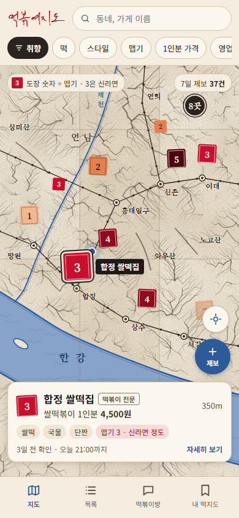 메인 v2 (A 먹과 쪽빛)</td>
<td align="center">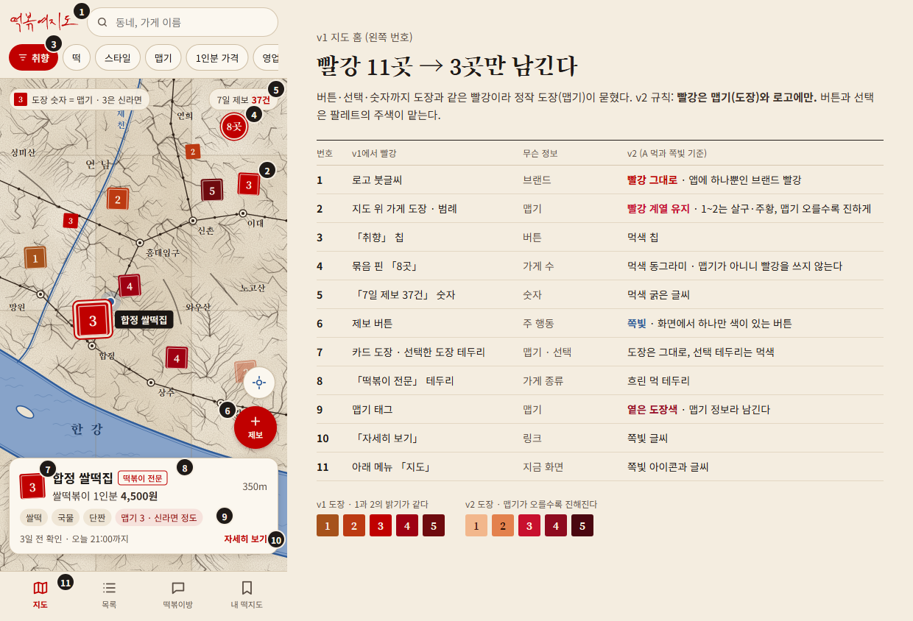 v1 → v2 빨강 정리</td>
</tr>
</table>

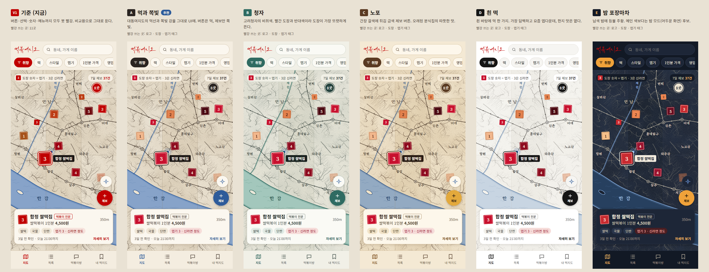 같은 메인 화면 · 팔레트 6가지

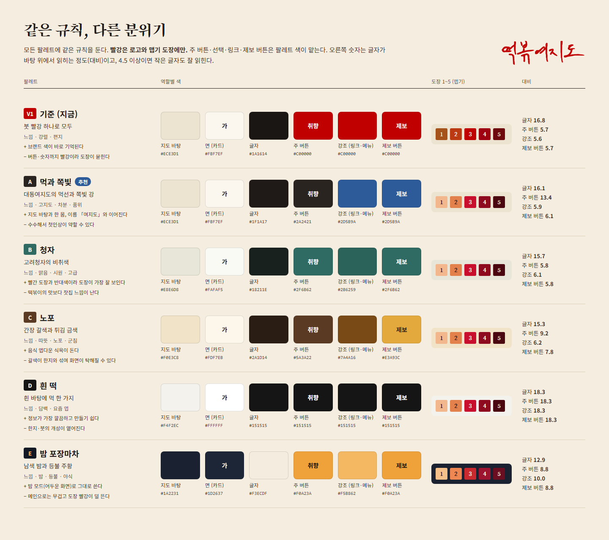 색 팔레트 비교판 (역할별 색 · 도장 1~5 · 대비)

<table>
<tr>
<td align="center">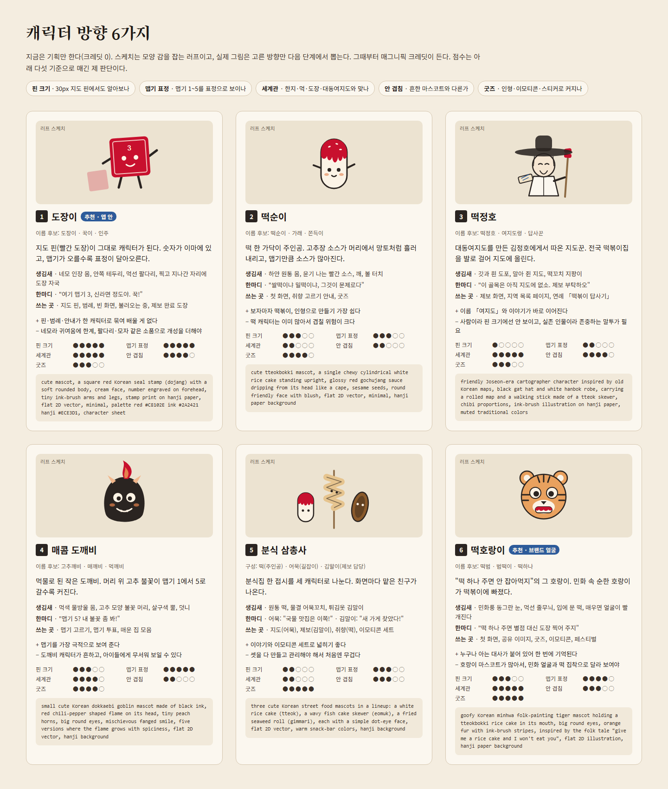 캐릭터 방향 6가지</td>
<td align="center">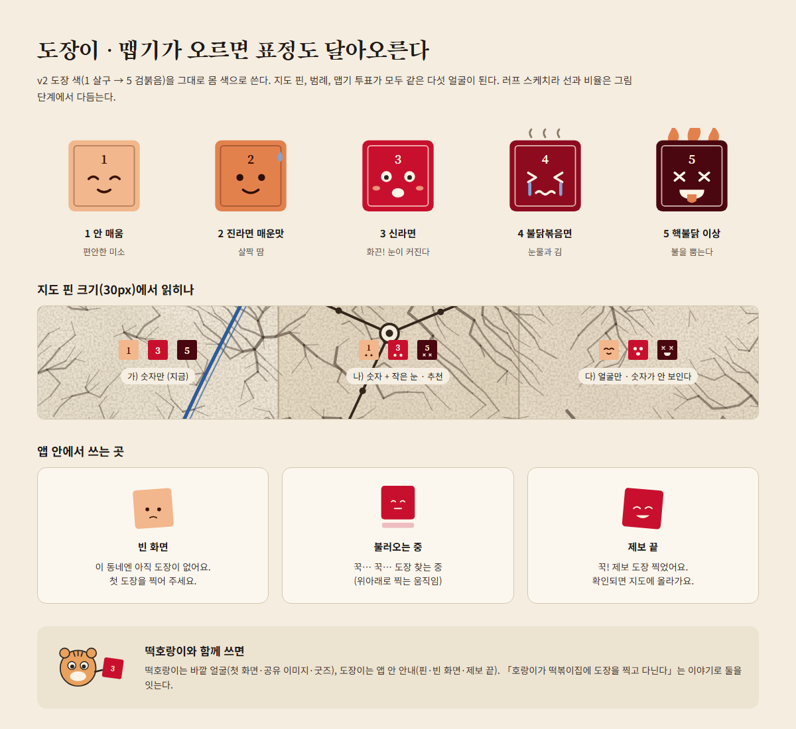 추천 깊게 · 도장이</td>
</tr>
</table>

## 정한 것 (제안, 사용자 확인 전)

- **v2 색 규칙:** 빨강은 로고와 맵기 도장에만. 버튼·선택·숫자·메뉴는 팔레트 주색. v1 메인에서 빨강 11곳 → 로고·도장·맵기 태그 3곳.
- **도장 1~5 새 색:** 살구 #F2B78C → 주황 #E3814D → 빨강 #C8102E → 진홍 #8E0B1F → 검붉음 #4A0710 (맵기 오를수록 진하게). v1은 1과 2의 밝기가 같았다(0.14).
- **팔레트 6가지:** V1 기준 / A 먹과 쪽빛(추천) / B 청자 / C 노포 / D 흰 떡 / E 밤 포장마차(밤 모드 후보). 모든 팔레트 글자 대비 4.5 넘음(`만든_스크립트/contrast_v2.py`).
- **캐릭터 6가지:** 1 도장이(추천·앱 안) / 2 떡순이 / 3 떡정호(김정호 오마주) / 4 매콤 도깨비 / 5 분식 삼총사 / 6 떡호랑이(추천·브랜드 얼굴, "떡 하나 주면 안 잡아먹지"). 카드마다 그림 프롬프트 초안(영어) 있음.

## 페이지 합치기 · 기존과 나란히 (10-26 밤, 2)

- 캔버스 페이지는 4개: 스튜디오 · 메인 화면(+ 중립 팔레트 비교 · 지도 확대 · 가장자리) · 색 팔레트(기존 + 중립) · 캐릭터.
- 스튜디오 개선안 탭 = 위 팔레트 칩을 누르면 오른쪽 개선안이 바뀌고, 왼쪽은 늘 기존 디자인(v1). 기존 가게 상세는 v1 화면 사진(`그림/v1_store_top.png`).
- 프로토타입 탭 기본 = 기존과 나란히.

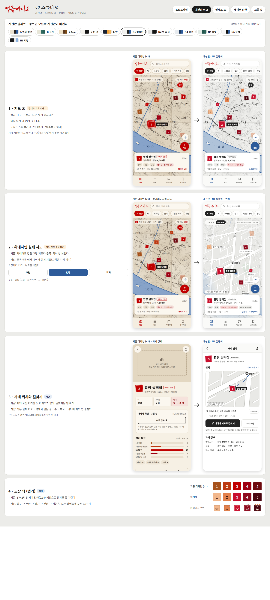 개선안 탭 · 기존(v1) ↔ 개선안

## 스튜디오 · 프로토타입 (10-26 밤)

사용자: 「개선 방안·비교 시안을 캔버스 페이지(#page-2e9cfe98992d)에 올리고, 웹 스튜디오로 보고, 프로토타입처럼, 거기서 팔레트 비교, 캐릭터 기획 방향도」
→ 그 주소 그대로 열리게 페이지 id `2e9cfe98992d`(이름 「스튜디오」)를 만들고 첫 페이지·시작 화면으로 둠. 판 하나 `Studio.dc.html`(웹 페이지형, 누르면 움직임).

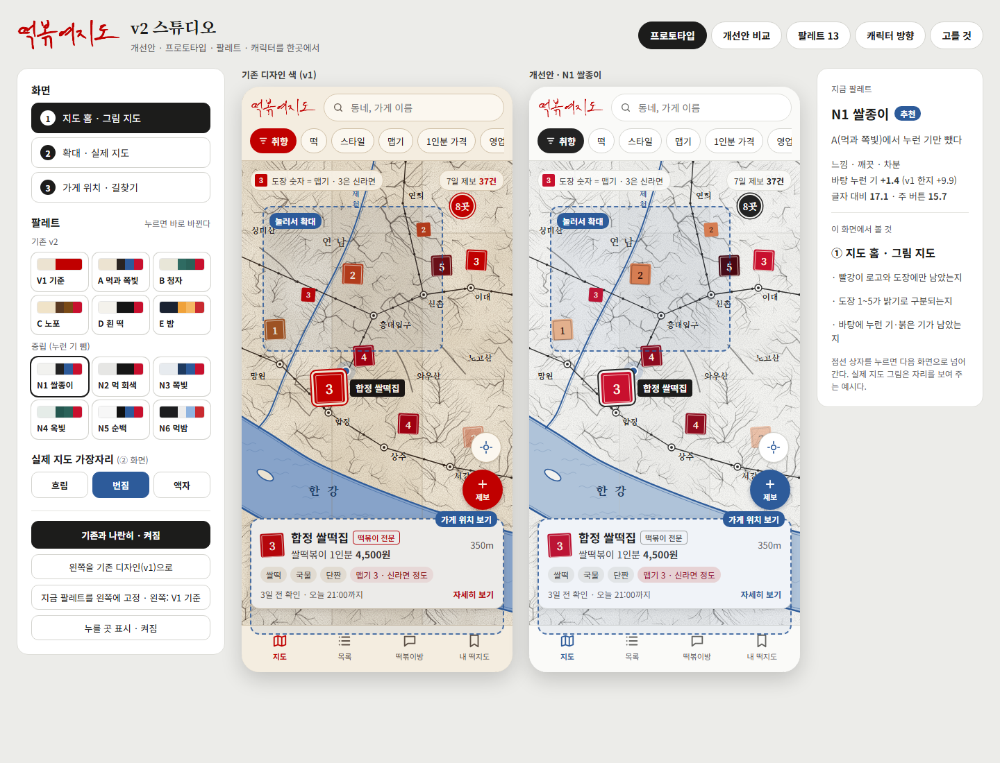 프로토타입 탭

| 탭 | 내용 |
| --- | --- |
| 프로토타입 | 지도 홈 → 확대(실제 지도) → 가게 위치. 점선 상자를 누르면 넘어감, 길찾기·주소 복사는 안내 문구. 팔레트 13가지 즉시 바꾸기, 「두 팔레트 나란히」(왼쪽 고정 + 지금), 가장자리 흐림/번짐/액자, 누를 곳 표시 끄기 |
| 개선안 비교 | 1 빨강 줄이기 · 2 누런 기 빼기 · 3 확대하면 실제 지도 · 4 가장자리 · 5 도장 색 밝기 순 · 6 가게 위치·길찾기 (전/후 작은 화면 + 상태) |
| 팔레트 13 | 카드를 누르면 그 팔레트로 프로토타입이 열림 |
| 캐릭터 방향 | 6가지 목록 → 고르면 스케치·설명·점수·프롬프트, 추천 조합(도장이 + 떡호랑이), 도장이 맵기 표정 1~5 |
| 고를 것 | 팔레트 · 가장자리 · 지도 엔진 · 캐릭터 · 핀 얼굴 · 기획안 남은 것 (추천 표시, 저장 안 됨) |

- ZoomStreet·ZoomStore 도 13가지 팔레트를 다 받도록 넓힘(B~E용 실제 지도 자리 그림 street_B~E 추가).
- 캐릭터 스케치·도장이 표정은 그림 파일로 뽑아 씀(`그림/캐릭터/char_1~6.svg`, `face_1~5.svg`).
- 기존 팔레트 B~E 바탕 누런 기: B +7.0 · C +14.8 · D +3.1 · E −11.0(푸름).

## 추가 (10-26 저녁) · 중립 팔레트 + 확대하면 실제 지도

사용자: 「배경색에도 붉은 기가 있다 → 제거한 색상 템플릿 여러 개」 · 「확대하면 네이버 지도와 연동해서(사이드는 블러처럼 처리하더라도) 정확한 위치를 보여 줘야 하지 않나」

캔버스에 페이지 2개 추가: **중립 팔레트** · **지도 확대**

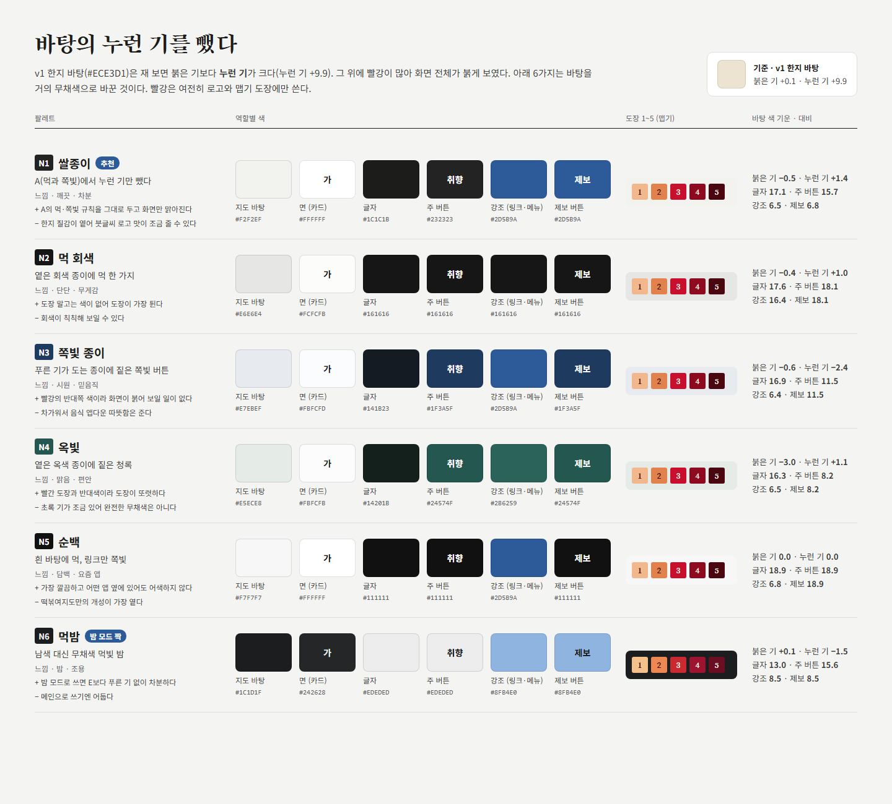 중립 팔레트 6가지

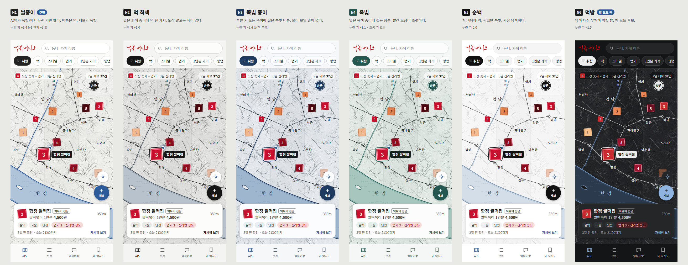 같은 메인 화면 · 중립 팔레트 6가지

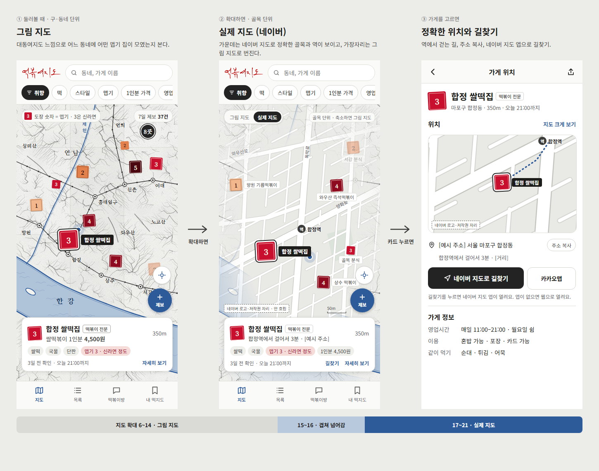 그림 지도 → (확대) 실제 지도 → (가게 카드) 위치·길찾기

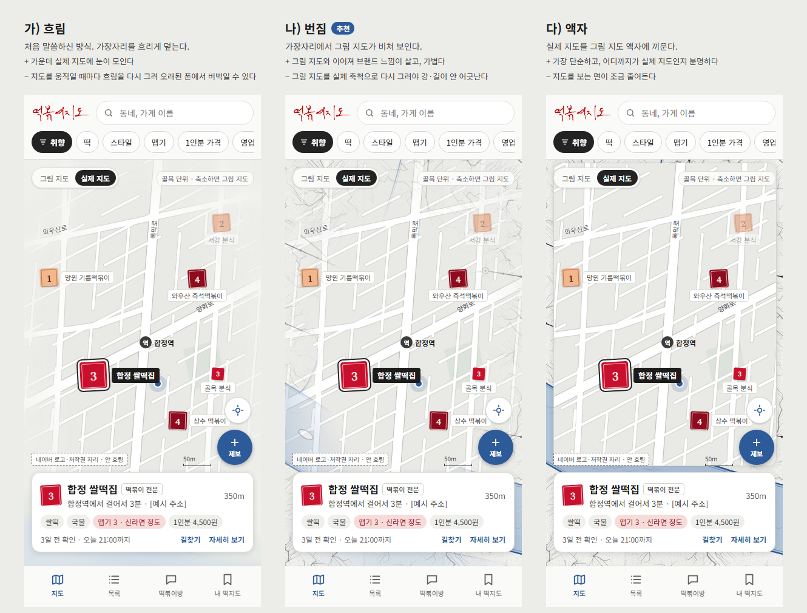 실제 지도 가장자리 처리 · 흐림 / 번짐 / 액자

- **측정 결과:** v1 한지 바탕 #ECE3D1 은 붉은 기 a +0.1, 누런 기 b +9.9 → 붉은 기보다 **누런 기**가 문제. 위에 빨강이 많아 붉게 느껴졌다.
- **중립 팔레트 6:** N1 쌀종이(추천, A의 누런 기만 뺌) / N2 먹 회색 / N3 쪽빛 종이 / N4 옥빛 / N5 순백 / N6 먹밤(밤 모드 짝). 누런 기 −2.4~+1.4, 글자 대비 모두 4.5 넘음(`neutral_check_v2.py`).
- **지도 확대 구조(제안):** 확대 6~14 그림 지도 → 15~16 겹쳐 넘어감 → 17~21 네이버 실제 지도. 가게를 고르면 위치 카드(역에서 걷는 길·주소 복사·네이버 지도 앱 길찾기).
- **가장자리:** 가) 흐림(사용자 아이디어) / 나) 번짐(추천) / 다) 액자. Tweaks `edge` 로 바꿔 본다.
- **실제 지도 그림은 예시:** `street_*.svg` 는 네이버 지도 화면이 아니라 직접 그린 자리표시 그림이다. 진짜 화면은 API 키를 받아 시험해 봐야 한다.
- **꼭 알아 둘 것:** 그림 지도(map_*.svg)는 실제 축척이 아니라서 번짐 화면에서 강 위치가 실제 지도와 어긋난다. 실제로 이어 붙이려면 그림 지도를 실제 좌표(공개 지도 데이터 등)로 다시 그려야 한다.

네이버 지도 API 확인한 것(2026-10-26, 공식 문서):
- Maps에 **Map Style Editor**(지도 스타일 편집기) 있음 → 육지·도로·수계·글자 색, 항목별 보이기 끄기 가능. Web Dynamic Map에 「사용자 정의 지도 유형」 있음.
- 무료 이용량은 **대표 계정에만**(Maps를 처음 쓴 계정, 개인은 전화번호당 1개). 정확한 무료 건수·단가는 콘솔에서 확인 필요.
- 예전 AI NAVER API의 지도 API는 2025-07-01부터 무료 이용량 종료(공지).
- 지도 컨트롤에 「NAVER 로고」「지도 데이터 저작권」이 있음 → 가장자리 처리할 때 이 자리는 흐리게 하지 않게 비워 둔다. 덮어도 되는 범위는 약관 원문 확인 필요.
- 길찾기는 Maps의 「네이버 지도 앱 연동 URL Scheme」으로 앱을 연다.

## 파일

| 경로 | 내용 |
| --- | --- |
| 화면/Main.dc.html | 메인 v2. Tweaks의 `palette` 로 6가지 팔레트를 바꿔 본다 |
| 화면/RedAudit.dc.html | v1 화면에 빨강 11곳 번호 → v2에서 어디로 가는지 |
| 화면/MainCompare.dc.html | Main 을 팔레트 6가지로 불러와 나란히 |
| 화면/Palette.dc.html | 팔레트 비교판 |
| 화면/Character.dc.html | 캐릭터 방향 6가지 (러프 스케치·점수·프롬프트) |
| 화면/CharacterStamp.dc.html | 도장이 맵기 표정 1~5, 30px 핀 크기 시험, 쓰임, 떡호랑이와 함께 쓰기 |
| 화면/NeutralPalette.dc.html | 중립 팔레트 비교판(붉은 기·누런 기 수치) |
| 화면/MainCompareNeutral.dc.html | Main 을 중립 팔레트 6가지로 나란히 |
| 화면/ZoomFlow.dc.html | 그림 지도 → 실제 지도 → 가게 위치 흐름 + 확대 단계 |
| 화면/ZoomStreet.dc.html | 확대 화면. Tweaks `palette`(N1~N6·A) · `edge`(흐림/번짐/액자) |
| 화면/ZoomStore.dc.html | 가게 위치 카드 · 걷는 길 · 주소 복사 · 네이버 지도 길찾기 |
| 화면/ZoomEdgeCompare.dc.html | 가장자리 3가지 나란히 |
| 그림/map_A~E.svg, map_N1~N6.svg | 팔레트별 그림 지도 바탕(지형은 v1과 같음) |
| 그림/street_A.svg, street_N1~N6.svg | 확대 화면용 「실제 지도 자리」 예시 그림 |
| 만든_스크립트/gen_street_v2.py | street_*.svg 생성 |
| 만든_스크립트/neutral_check_v2.py | 중립 팔레트 붉은 기·누런 기·대비 계산 |
| 만든_스크립트/gen_map_v2.py | `python -I gen_map_v2.py <폴더>` → map_A~E.svg |
| 만든_스크립트/contrast_v2.py | 팔레트·도장 대비 계산 |

`화면/*.dc.html` 의 그림 주소(`/_blob/…`)는 온라인 캔버스 안에서만 열린다. 화면 이미지는 캔버스와 같은 런타임으로 로컬에서 그려 찍은 것.

그림 주소 대응: map A `a410bb70…` · B `580d3eff…` · C `59437296…` · D `c7551185…` · E `27260cd1…` · 서명 로고 `1db414b5…` · 큰 로고 `bac71ceb…` · v1 메인 사진 `2e4b424c…`
